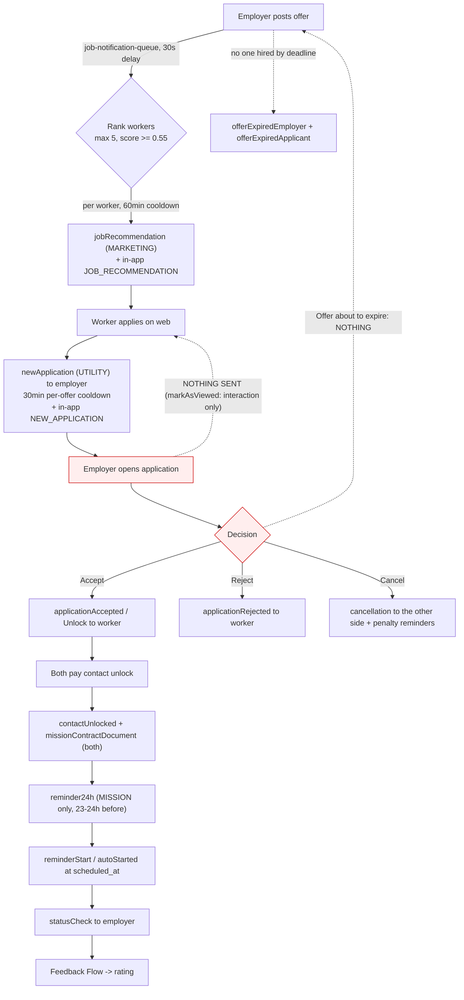

# Notifications & re-engagement audit

Audit of how Rabotka notifies and re-engages workers and employers, across `rabotka-backend`, `rabotka-client`, `rabotka-admin` and `rabotka-mobile`. Read-only: no code was changed, no package installed, no migration run. All paths are relative to `rabotka-backend/` unless stated otherwise.

---

## 1. Summary

Rabotka's notification layer is more built-out than it looks: ~35 approved French WhatsApp templates, a five-channel stack (WhatsApp, e-mail, in-app inbox, admin inbox, Socket.IO), per-send idempotency, a delivery log that records Meta's own `pricing.category` / `billable`, and BullMQ retries with a DLQ. The problems are not missing plumbing — they are **cost, window-awareness and re-engagement policy**.

Three findings dominate:

1. **Almost every send ignores the 24h customer-service window.** Only 4 call sites call `isServiceWindowOpen` (`penalty-notification.processor.ts:135`, `identity-check.service.ts:434`, `whatsapp-feedback.service.ts:57`, `whatsapp.service.ts:698`). The other ~30 send an approved template unconditionally. Under the pricing rule stated in the brief (utility templates billed from 1 Oct 2026 even inside the window), the free-form + `sendInteractiveCta` path that already exists in `whatsapp-outbound.processor.ts:373-420` — free-form text with a URL button, falling back to the template on any failure — is never reused by the lifecycle senders. This is the single largest avoidable line item.
2. **Nothing reopens the free window.** Every notification template ends in a **URL button**. Tapping a URL button does not send a message to the business, so it never reopens the 24h window; a quick-reply button or a question does. Rabotka pays per template precisely because its own messages never invite the reply that would make the next one free.
3. **No 72h free-entry-point support and no opt-out.** `referral` (the Click-to-WhatsApp payload) is not parsed anywhere — `providers/cloud/cloud.types.ts` has no such field — so ad-driven conversations are neither free-window-aware nor attributable. There is no opt-out record, no per-user frequency cap across all templates, no quiet hours, and no monitoring of the WABA quality rating or messaging tier.

Relevance is in good shape: there are no generic "come back" blasts, and the only MARKETING-category user notification (`jobRecommendation`) is a real match capped at 5 workers per offer. The gaps are the silent steps of the lifecycle — an employer opening an application, an offer about to expire, a worker losing a filled offer — and the absence of any digest or backoff for people who never answer.

Fourth, and the one the team asked for directly: **an admin cannot send one message to a group of users.** The back office can message exactly one profile at a time (`POST /admin/profiles/:id/messages`), and the only fan-out that exists is the paid Advertisement module — whose stored audience filters are never applied. Section R11 designs the missing feature, deliberately after R1–R4, because a broadcast built before the window logic, the opt-out and the frequency cap exist is the fastest way to lose the WhatsApp quality rating.

---

## 2. Current state

### 2.1 Stack

| Concern | Implementation | Files |
|---|---|---|
| Provider | Meta Cloud API active (`WHATSAPP_PROVIDER=cloud`), Twilio retained behind the same interface | `whatsapp/whatsapp-provider.factory.ts`, `whatsapp/providers/cloud/*` |
| Send facade | `WhatsAppService` — every send in the codebase goes through it | `whatsapp/whatsapp.service.ts` |
| Template registry | 35 entries, key → Meta name + category + variable map | `common/constants/whatsapp-templates.ts` |
| Template bodies | Authored for Meta submission (the only place the French copy is in-repo) | `scripts/whatsapp-templates/definitions.ts` |
| Delivery log | `whatsapp_messages` — status, error codes, `pricing_category`, `billable` | `prisma/schema.prisma:1291`, `whatsapp/logging/whatsapp-message-log.service.ts` |
| Inbound | Webhook → Redis dedupe → `whatsapp-inbound-queue` → bot router → Vova AI (RAG) | `whatsapp/webhooks/*`, `whatsapp-inbound.processor.ts`, `bot/router/*`, `rag/vova.service.ts` |
| Outbound queue | Bot replies only, with DLQ | `whatsapp/whatsapp-outbound.processor.ts` |
| In-app inbox | `ProfileNotification`, 14 types, Socket.IO `/notifications` | `modules/profile-notification/*` |
| Scheduling | BullMQ repeatables; reminders scan every 15 min | `bot/reminder/reminder-scheduler.service.ts:6` |

Terminology note: *zakaz* appears nowhere in the code — the entity is `JobOffer` ("offre"/"mission"). `rag/docs/PROJECT_CONTEXT.md:217-220` already records this correction, and `rag/retrieval/aliases.ts:7` keeps the alias for retrieval only.

### 2.2 Every WhatsApp send

**Free-form text** (`sendTextMessage` — free inside the window, rejected outside it):
`payment-request.service.ts:758,888` · `poll-payment-status.processor.ts:253` · `profile.service.ts:2526` · `bot-notification.service.ts:619,706` · `event/senders/whatsapp-event.sender.ts:39` · `advertisement/services/ad-notification.service.ts:111,132` · `whatsapp-outbound.processor.ts:226` · `whatsapp.service.ts:867` (post-activation welcome) · `whatsapp-feedback.service.ts:60`.

**Interactive CTA** (free-form + one URL button, window-checked or fallback-guarded):
`penalty-notification.processor.ts:155` (checks the window, postpones if closed) · `identity-check.service.ts:440` (checks, falls back to template at `:462`) · `whatsapp-outbound.processor.ts:385` (falls back to the template on any failure).

**Flow** (native in-chat form): `whatsapp-feedback.service.ts:74`, window-checked at `:57`.

**Media**: `advertisement/services/ad-notification.service.ts:100,121` — ad images, sent free-form with **no window check**.

**Templates** — the lifecycle senders, none of which checks the window:

| Trigger | Recipient | Template (category) | File |
|---|---|---|---|
| Web signup | both | `profileCreatedWorker` / `…Employer` (UTILITY) | `profile/profile.controller.ts:162` |
| OTP login | both | `otp` (AUTH) | `auth/auth.service.ts:815` |
| KYC approved | both | `kyc` + `kycAgreementDocument` (UTILITY) | `profile/admin-profile.controller.ts:864`, `kyc/kyc.service.ts:44`, `whatsapp/documents/whatsapp-document.service.ts:114` |
| KYC rejected | both | `kycRejected` (UTILITY) | `admin-profile.controller.ts:906` |
| Account activated / suspended | both | `accountActivated*` / `accountSuspended` | `profile.service.ts:594,1176,1244` |
| **New application** | employer | `newApplication` (UTILITY) | `bot-notification.service.ts:165`, 30-min per-offer cooldown at `:128-145` |
| **Accepted** | worker | `applicationAccepted` / `…Unlock` | `bot-notification.service.ts:244,256` |
| **Rejected** | worker | `applicationRejected` | `bot-notification.service.ts:367,380` |
| **Cancelled** (either side) | other side | `cancellation` | `bot-notification.service.ts:522,562` |
| Contact unlocked | both / employer | `contactUnlocked`, `contactUnlockedRecommendation`, `missionContractDocument` | `bot-notification.service.ts:680`, `recommendation-contact.service.ts:168`, `payment-request.service.ts:1083` |
| Unlock expired → credit | worker | `unlockExpiredConversion` | `bot-notification.service.ts:761` |
| **New matching offer** | worker | `jobRecommendation` (**MARKETING**) | `job-offer/notification/job-notification.service.ts:251` → `bot-notification.service.ts:718-783` |
| 24h / start / auto-start / status-check / expiry | both | `reminder24h`, `reminderStart`, `autoStarted`, `statusCheck`, `offerExpired*` | `bot/reminder/reminder.processor.ts:416,465,620,667,719,765,849` |
| Claim answered | complainant | `claimCommented` | `claim/claim.service.ts:650` |
| Profile views pile up | worker | `profileViewsDigest` | `profile-notification/profile-views-reminder.listener.ts:82` |
| Identity check | user | `identityCheckConsent` | `identity-check.service.ts:462` |
| Admin message | user | free-form in-window, else `adminMessage` (**MARKETING**) | `admin-profile.controller.ts:568` → `whatsapp.service.ts:690-788` |

**Dead registry entries** (0 call sites outside the registry, tests and scripts): `kycPendingMenu`, `viewWorkerPortfolio`, `offerUnavailableWorker`.

### 2.3 Categories and language

All 35 templates are French only — `CLOUD_DEFAULT_LANGUAGE = 'fr'` (`whatsapp-templates.ts:181`), no other locale exists despite the backend carrying `nestjs-i18n` (fr/en/ru). Categories: 1 AUTHENTICATION (`otp`), 3 declared MARKETING (`welcomeUnregisteredCard`, `welcomePlatform`, `jobRecommendation`), plus `adminMessage` which Meta reclassified — see the comment at `whatsapp-templates.ts:1306-1328` — and the remaining ~30 UTILITY.

### 2.4 The 24h window

Tracked, but derived rather than stored: `isServiceWindowOpen` (`whatsapp.service.ts:654-679`) reads the newest `Message` row with `direction=INBOUND, platform=WHATSAPP` and applies a 5-minute safety margin. There is **no `last_inbound_at` column** on `Profile`, so each check is a query, and the window cannot be filtered on in bulk (which is why no fan-out uses it).

### 2.5 The 72h free entry point

Not implemented. `referral` is absent from `providers/cloud/cloud.types.ts`, so a Click-to-WhatsApp or Page-button conversation is indistinguishable from any other. `cloud.types.ts:309` names `FREE_ENTRY_POINT` in a comment on the pricing type, and nothing reads it.

### 2.6 Matching → notification

`job-offer.service.ts:556` enqueues after create; the processor delays 30s; `job-notification.service.ts:91-164` ranks (v2 engine, else legacy `matching.service.ts`), then fans out with concurrency 5. Gates: `matching.recommendations_enabled`, `min_notification_score` 0.55, `max_notification_workers` **5**, `notify_require_verified` false, per-worker global cooldown 60 min (`job_notif_cooldown:<id>`), per-pair sent marker 24h (`system-config/system-config.constants.ts:300-380`). Filters are category + vector similarity + geo; **there is no availability or "not already working that day" filter**, and no batching — 5 individual MARKETING templates per offer, instantly.

### 2.7 Opt-in / opt-out, frequency, quiet hours

None. No opt-out table, no preference model, no `STOP` keyword handling in `bot/router/bot-router.service.ts` (an unknown message returns the `openApp` card), no quiet hours, no timezone gate on sends — `APP_TIMEZONE` is used only to *format* times (`reminder.processor.ts:846`). The only rate controls are the two Redis cooldowns above and `fees.penalty_max_notifications` / `…_interval_hours`.

### 2.8 Delivery statuses, retries, logging

Good. `whatsapp-message-log.service.ts:345-410`: rank-guarded forward-only status transitions, timestamps set unconditionally, `pricing_category` + `billable` merged when Meta attaches them to `delivered`, error code/message stored. Correlation via `biz_opaque_callback_data` carrying our own row id, with a provider-id fallback. Idempotency: inbound claim/release (`idempotency.service.ts`), outbound duplicate guard keyed on phone+template+params hash, failing **open** (`whatsapp.service.ts:250-276`). Prometheus counters in `whatsapp/telemetry/metrics.ts`. Admin console: `whatsapp-admin/*` (log, stats, billing, queue/DLQ retry).

Gaps: template sends from HTTP handlers bypass the outbound queue entirely (`sendTemplateMessage` → provider, one attempt, failure swallowed to `false`), so only bot replies get BullMQ retries; there is no alert on failure rate or on specific error codes, and no polling of the WABA quality rating / messaging tier.

### 2.9 Web push

None anywhere. `rabotka-client` has no service worker, manifest, `PushManager` or VAPID key; `rabotka-mobile` has no `expo-notifications`. And note the constraint the brief raises: the client is opened from a WhatsApp CTA button, i.e. inside WhatsApp's **in-app browser**, which does not support Web Push — so push would only ever work for users who open the site in a real browser or install the PWA. Web push is therefore an *addition* to WhatsApp, never a replacement.

### 2.10 Lifecycle diagram



---

## 3. Problems found

### P1 — Templates are sent without checking the 24h window · **HIGH** · cost
~30 call sites (see 2.2) call `sendTemplateMessage` unconditionally. Under the rule in the brief, a UTILITY template costs the same inside an open window as outside it, while the free-form equivalent is free. Every notification to someone who wrote to the bot in the last 24h — the engaged users, i.e. the ones notified most — is paid for needlessly. The replacement pattern already exists and is proven: `whatsapp-outbound.processor.ts:373-420` sends `sendInteractiveCta` (free-form + URL button, which is what the templates are for) and falls back to the approved template on any failure.
**Estimated impact:** saves the template fee on every notification landing in an open window. Measurable today — see the verification queries at the end.

### P2 — Nothing reopens the free window · **HIGH** · cost + engagement
Every notification template ends in a URL button only (`urlSuffixVar` / `buttonUrlVar` across the registry). A URL tap is not an inbound message, so the window stays closed and the *next* notification is billed again. No template offers a quick reply, and no body ends in a question. `contactUnlocked` is the one exception, with a Flow button (`whatsapp-templates.ts:980-1017`).

### P3 — No 72h free-entry-point handling · **HIGH** · cost + attribution
`referral` is never parsed (2.5), so a conversation opened from a Click-to-WhatsApp ad is treated like any other: messages Meta would deliver free are sent as paid templates, and ad spend cannot be tied to signups. This matters most for exactly the users who arrive through paid acquisition.

### P4 — No opt-out, no global frequency cap, no quiet hours · **HIGH** · quality rating
No `STOP` handling, no preference record, no cap on the *total* number of messages a person receives (the two cooldowns are per-recommendation and per-offer), and no time-of-day gate: the reminder scan runs every 15 minutes, so `reminder24h` for a 06:00 mission fires around 06:00 the previous day, but nothing prevents other paths from sending at 02:00. A single block-and-report wave lowers the WABA quality rating and drops the messaging tier — which silently throttles *all* notifications, including transactional ones.

### P5 — Silent lifecycle steps · **MEDIUM** · relevance/retention
- Employer views an application: `application.service.ts:2423-2459` records an interaction and sends nothing. For a worker this is the strongest "you are being considered" signal in the product.
- No "your offer expires in X hours / no one applied yet" to the employer; the only expiry message is after the fact (`reminder.processor.ts:620,667`).
- A worker whose offer is filled by someone else gets nothing — `offerUnavailableWorker` is an approved template with **zero call sites**.
- No rating reminder if the Flow is ignored; no "mission completed, confirm" to the worker.

### P6 — `jobRecommendation` is MARKETING · **MEDIUM** · cost + deliverability
It is the most-sent user-facing notification and sits in the most expensive category, and marketing messages honour Meta-level opt-out — a worker who opted out silently stops receiving job matches, which is the core value of the product. Meta's category assignment is the constraint; the body is genuinely transactional in intent (a response to a match). Worth one re-submission attempt as UTILITY with reworded copy, and worth sending in-app first where the worker is active.

### P7 — Ad dispatch sends free-form outside the window · **MEDIUM** · reliability
`advertisement/services/ad-notification.service.ts:100-132` sends media and text with no window check, so any ad to someone who has not written in 24h fails at the provider. Related: `ad-targeting.service.ts` never reads the stored `target_filters` (it selects `status=ACTIVE` of the bundle's profile type, `ORDER BY RANDOM()`), so paid targeting is not applied at all.

### P8 — Lifecycle sends have no retry · **MEDIUM** · reliability
`sendTemplateMessage` from an HTTP handler is one attempt; `attempt()` swallows the failure into `false` (`whatsapp.service.ts:159-182`) and most callers ignore the return. A transient Meta 5xx loses the notification permanently. Only bot replies go through `whatsapp-outbound-queue` with retries and a DLQ.

### P9 — No quality/tier or cost observability · **MEDIUM**
The data is in `whatsapp_messages` (`billable`, `pricing_category`, `error_code`) and the admin console shows stats, but nothing polls the WABA quality rating or messaging limit, and nothing alerts on a failure-rate or error-code spike (131047, 131050, 132000…).

### P10 — Registry drift · **LOW**
Three approved templates with no sender (2.2). `offerUnavailableWorker` is not dead weight but a missing feature (P5); the other two are leftovers to delete in Business Manager or wire up.

### P11 — No preference or digest option · **LOW→MEDIUM**
Everything is immediate and per-event. A worker matched by three employers in an evening gets three messages (the 60-min cooldown thins this, at the cost of dropping matches entirely rather than batching them). No daily digest, and no backoff for someone who has not opened a message in weeks — the data for both is already in `whatsapp_messages.read_at` and `InteractionEvent`.

### P12 — No admin broadcast · **HIGH** · missing capability
An admin can message one profile at a time (`profile/admin-profile.controller.ts:488-620`, `channel: WHATSAPP|EMAIL`, window-aware via `sendAdminMessage`) and nothing more. There is no announcement, campaign or segment send:
- no `Broadcast` entity in `prisma/schema.prisma`;
- the only fan-out is `advertisement/services/ad.processor.ts` — a paid third-party ad product whose audience filters (`advertisement/dto/target-filters.dto.ts`, stored in `Advertisement.target_filters`) are **never read** by `ad-targeting.service.ts`, which selects `status=ACTIVE` of the bundle's profile type with `ORDER BY RANDOM() LIMIT max_reach`;
- `rabotka-admin` has no broadcast page and no reusable multi-select or audience component (the closest are the channel checkbox group in `features/ads-bundles/components/bundle-dialog.tsx` and the profile-list filters in `hooks/use-profiles-list.ts`).

Consequences: platform announcements (maintenance, a fee change, a new feature, a recruitment push in one neighbourhood) are either not sent or sent by hand, one profile at a time. And when it *is* built naively — a loop over profiles calling `sendTemplateMessage` — it becomes the single most expensive and most quality-rating-dangerous code path in the product: a MARKETING template per recipient, no opt-out, no cap, no window check.

---

## 4. Recommended changes, by impact ÷ effort

### R1. Window-aware send helper (highest impact, ~1 day) *(P1)*
Add `NotificationDispatcher.send({profileId, phone, templateKey, params, freeForm: {body, buttonText, path}})` in a new `modules/notification-dispatch/`: check `isServiceWindowOpen`, send `sendInteractiveCta` when open, the template otherwise, and fall back to the template on any failure. Migrate the ~30 call sites in `bot-notification.service.ts`, `reminder.processor.ts` and the `application.service.ts` paths. The free-form French bodies must be written in-repo (they currently live only at Meta) — put them beside the existing copy in `bot/messages/*.messages.ts`.
*Files:* new module; all senders listed in 2.2. `whatsapp.service.ts` needs nothing new — it already exposes both paths.
*New field:* `Profile.last_inbound_at DateTime?`, written by `conversation.service.ts:107`, so the window becomes a column rather than a query — required by R4, R6 and R11.

### R2. Reopen the window on purpose (~0.5 day + Meta approval) *(P2)*
Add a quick-reply button to the highest-volume templates (`newApplication`, `jobRecommendation`, `applicationAccepted`, `reminder24h`): « Voir » / « Je confirme » / « Plus tard ». Handle the reply in `bot-router.service.ts` — a tap arrives as an inbound message, so R1's free path opens for every following send to that person.

### R3. Free entry point, 72h (~1 day) *(P3)*
Parse `messages[].referral` in `webhooks/inbound-normalizer.ts`, store `entry_point_at` + `ctwa_clid` (new columns on `Profile`, or a small `WhatsappEntryPoint` table), and let R1 treat "within 72h of an entry point" as free-form-eligible. Bonus: ad attribution for the marketing spend.

### R4. Opt-out, caps and quiet hours (~1.5 days) *(P4)*
New `NotificationPreference` (profile_id, channel, type, enabled, digest `INSTANT|DAILY`, quiet_from/quiet_to) plus a `STOP` / `STOPPER` keyword in the router that writes an opt-out. Enforce in R1's dispatcher: a global cap (e.g. ≤4 non-transactional messages per week), quiet hours 21:00–07:00 Africa/Brazzaville using `APP_TIMEZONE`, and a backoff tier for profiles with no inbound message in 30 days. Transactional messages (OTP, accepted, contract, penalty) are exempt from the cap but not from quiet hours.

### R5. Fill the silent steps (~1 day) *(P5)*
- `markAsViewed` (`application.service.ts:2423`) → in-app `APPLICATION_VIEWED` plus a WhatsApp message only when the window is open (new `ProfileNotificationType`, needs a client release — see the schema comment at `prisma/schema.prisma:1605`).
- Wire `offerUnavailableWorker` into the auto-reject path (`application.service.ts:1398`, `job-offer.service.ts:1070`).
- New `offerExpiringSoon` to the employer, from the existing `reminder.processor.ts` scan: offers with `scheduled_at` in 12–24h and no ACCEPTED application.

### R6. Digest for recommendations (~1 day) *(P11, P6)*
Keep the in-app notification immediate (already the case); send WhatsApp only when the worker has no unread in-app notification and the window is closed; otherwise accumulate and send one « 3 nouvelles missions près de chez vous » digest at 08:00 local. `profileViewsDigest` (`whatsapp-templates.ts:1398`) is the working precedent, threshold and cooldown config included.

### R7. Ad dispatch fixes (~0.5 day) *(P7)*
Window-check in `ad-notification.service.ts` before the free-form and media sends; make `ad-targeting.service.ts` read `target_filters` — ideally through R11's shared `buildAudienceWhere`, so targeting and broadcast audiences cannot drift.

### R8. Retries for lifecycle sends (~0.5 day) *(P8)*
Route R1's dispatcher through `whatsapp-outbound-queue` for everything that is not user-blocking, so all notifications inherit the existing retry and DLQ.

### R9. Cost & quality dashboard (~1 day) *(P9)*
Poll the Graph API for quality rating and messaging tier into the existing admin WhatsApp page; add a cost view grouped by `template_key` × `pricing_category` × `billable`; alert on failure rate and on 131047 / 131050.

### R10. Cleanup (~0.5 day) *(P10)*
Delete or wire the three dead templates; add a CI check that every registry key has a sender — the binding checker at `whatsapp-templates.ts:1526` is the natural home.

### R11. Admin broadcasts (~4–5 days, after R1/R4) *(P12)*
Build it on the dispatcher, the opt-out and the frequency cap from R1/R4 — never as a direct loop over `sendTemplateMessage`.

**Backend** — new `modules/broadcast/`:
- `Broadcast` (title, body, link, `channels DeliveryChannel[]`, `audience Json`, status `DRAFT|SCHEDULED|SENDING|SENT|CANCELLED|FAILED`, `scheduled_at`, `created_by`, `recipient_count`, `sent_count`, `failed_count`, `read_count`, `estimated_cost`) and `BroadcastRecipient` (broadcast, profile, channel, status, error, `sent_at`) with `@@unique([broadcast_id, profile_id, channel])`, so a retried chunk cannot double-send.
- `audience.ts` → `buildAudienceWhere(filters): Prisma.ProfileWhereInput`: profile type, account status (default ACTIVE), KYC status, country/city, categories, signup date range, `active_within_days` (`last_login_at`), `whatsapp_connected`, `has_email`, plus explicit include/exclude profile ids. Always excludes `deleted_at`, and — via R4 — anyone opted out. Reused by `ad-targeting.service.ts` (R7).
- Endpoints under `@Controller('admin/broadcasts')` with `AdminAuthGuard + RolesGuard`, `@Roles(MANAGER)` to send; DTO style from `profile/dto/admin-list-profiles.dto.ts`. `POST /audience/preview` → `{ total, reachable: { IN_APP, WHATSAPP, EMAIL }, freeWhatsapp, billableWhatsapp, estimatedCost, sample[5] }`; CRUD; `POST /:id/send` (`scheduled_at?`), `/cancel`, `/test` (to the admin's own profile); `GET /:id/recipients`. Audit every send through `logService`.
- Dispatch on a new `broadcast-queue` in the worker process: snapshot the audience into `BroadcastRecipient` rows (batched cursor), then chunk jobs of ~200. Per recipient: **in-app always** (batched `ProfileNotification.createMany` + socket emit, new `ANNOUNCEMENT` type); **WhatsApp** free-form + CTA when the window is open or inside a 72h entry point (free — R1/R3), otherwise the MARKETING template below, subject to opt-out, the weekly cap and quiet hours; **e-mail** only where an address exists. Throttle to Meta's rate limit; feed `read_at` back into `read_count`.
- `freeWhatsapp` vs `billableWhatsapp` in the preview is the direct payoff of R1's `Profile.last_inbound_at`: the admin sees, before sending, how much of the audience is reachable for free.

**Admin** (`rabotka-admin`) — routes `broadcasts/index|new|$broadcastId`; list page copied from `pages/jobs.tsx` + `hooks/use-jobs-list.ts`; API client extending `lib/api/base-controller.ts`. Create page in two columns: message, channels and schedule on the left (checkbox-group pattern from `features/ads-bundles/components/bundle-dialog.tsx`); audience builder plus a **sticky live count with cost estimate** on the right (debounced call to `/audience/preview`, five sample profiles, phone-style preview). Confirm dialog restating recipients, channels and estimated cost; "send test to me" first. Sidebar entry in `layouts/app-sidebar.tsx` (`MANAGER_UP`) and `lib/role-access.ts`. Surfaces are `bg-card shadow-soft rounded-lg` — no borders, so not the `Card` primitive.

**Client** (`rabotka-client`) — `ANNOUNCEMENT` in the notification type union (`lib/api/notification-controller.ts`) and its icon in the notification card; plus the toast on `notification:new` that the socket hook currently omits.

---

## 5. Proposed new / updated templates (French)

All `language: fr`, authored in `scripts/whatsapp-templates/definitions.ts`, following the house style (bold title line, blank line, body, « L'équipe Rabotka »).

**1. `applicationViewed` — UTILITY** *(new, R5)* · vars: `{{1}}` prénom, `{{2}}` titre de l'offre, `{{3}}` suffixe URL (`mes-candidatures`)
> *Votre candidature a été consultée*
>
> Bonjour {{1}}, l'employeur vient d'ouvrir votre candidature pour « {{2}} ».
> Gardez votre téléphone à portée de main.
>
> L'équipe Rabotka

Bouton URL : « Voir ma candidature »

**2. `offerExpiringSoon` — UTILITY** *(new, R5)* · vars: `{{1}}` titre, `{{2}}` nombre de candidatures, `{{3}}` heures restantes, `{{4}}` suffixe URL (`job-offers/<id>`)
> *Votre offre expire bientôt*
>
> « {{1}} » ferme dans {{3}} h et {{2}} candidature(s) attendent votre réponse.
> Choisissez un candidat avant la clôture pour que la mission ait lieu.
>
> L'équipe Rabotka

Bouton URL : « Voir les candidatures » · Réponse rapide : « Prolonger »

**3. `jobRecommendationDigest` — UTILITY demandé, MARKETING probable** *(new, R6)* · vars: `{{1}}` prénom, `{{2}}` nombre, `{{3}}` métier ou quartier, `{{4}}` suffixe URL (`recherche-offres`)
> *{{2}} nouvelles missions pour vous*
>
> Bonjour {{1}}, {{2}} missions correspondant à votre profil ({{3}}) ont été publiées.
>
> L'équipe Rabotka

Bouton URL : « Voir les missions » · Réponse rapide : « Stop »

**4. `jobRecommendation` — re-submit as UTILITY** *(updated, P6)* — same variables. Reframe as the answer to a profile the worker set up, not as an offer: « Une mission correspond aux critères de votre profil ». Per the lesson recorded at `whatsapp-templates.ts:1306-1328`: one submission, then accept Meta's verdict.

**5. Add a quick-reply button** *(updated, R2)* to `newApplication` (« Voir le candidat »), `applicationAccepted` (« Je confirme »), `reminder24h` (« Je serai présent(e) » / « J'ai un empêchement » — the second doubles as an early cancellation signal, which feeds the penalty rules).

**6. `broadcastAnnouncement` — MARKETING** *(new, R11)* · vars: `{{1}}` prénom, `{{2}}` message rédigé par l'admin (aplati et plafonné comme `adminMessage`), `{{3}}` suffixe URL
> *Information Rabotka*
>
> Bonjour {{1}},
> {{2}}
>
> L'équipe Rabotka

Bouton URL : « Ouvrir Rabotka » · Réponse rapide : « Stop »

Expect MARKETING whatever is requested: the lesson recorded on `adminMessage` (`whatsapp-templates.ts:1306-1328`) is that a body which is essentially one free variable reads as a broadcast — which this one genuinely is. Budget for it: billed per recipient, subject to marketing opt-out, and the first thing a quality-rating drop will be traced to. Inside an open window R11 sends the same words free-form and this template is never used.

**7. `optOutConfirmed` — UTILITY** *(new, R4)* · vars: `{{1}}` prénom
> Bonjour {{1}}, vous ne recevrez plus de suggestions de missions sur WhatsApp. Les messages concernant vos candidatures en cours continuent.
> Répondez « Reprendre » à tout moment.

---

## 6. Open questions

1. **Pricing premise.** The 1 Oct 2026 change (utility templates billed inside the 24h window) is taken from the brief; the repo has no pricing config to confirm it against. Can you point me at the Meta notice, or should R1 be validated first against a week of `whatsapp_messages.billable`?
2. **Free-form vs. the in-app browser.** The reason bot replies are templates at all is that *only* a template's CTA button opens WhatsApp's in-app browser (`whatsapp-templates.ts:416-420`, `bot/messages/welcome.messages.ts:26`). R1 assumes `sendInteractiveCta`'s button does the same — it is already used that way in `whatsapp-outbound.processor.ts` and `penalty-notification.processor.ts`. Confirmed in production, or should we verify before migrating the lifecycle senders?
3. **Cap on total messages.** Acceptable weekly ceiling per worker for non-transactional messages — 3, 4, 5?
4. **Quiet hours.** 21:00–07:00 Africa/Brazzaville, with OTP and mission-start reminders exempt?
5. **Digest vs. instant for matches.** Is a worker better served by an immediate match (current, capped at 5 workers per offer) or a morning digest? A digest cuts cost and fatigue but loses the first-mover advantage on urgent missions — which may be the point of the product.
6. **`max_notification_workers = 5`** per offer: a deliberate ceiling, or a cost compromise you would lift once R1 lowers the per-message cost?
7. **Web push.** Worth building for the minority who open the site outside WhatsApp, or is WhatsApp + in-app inbox the whole channel strategy until the Expo app ships?
8. **Opt-out scope.** Should `STOP` silence job matches only, or everything except OTP and payment-related messages?
9. **Broadcast ceiling (R11).** Channels for v1 are in-app + WhatsApp + e-mail. Should a broadcast have a hard recipient ceiling per send (e.g. 2 000) and a monthly spend cap, and should one above N recipients require a second admin's approval?
10. **Broadcast vs. opt-out.** Does an opted-out profile still receive an *operational* broadcast (maintenance, fee change) in-app while being excluded from WhatsApp, or excluded from both?

---

## Verification queries (run before any code change)

```sql
-- The real cost ranking, and the baseline R1 is measured against.
SELECT template_key, pricing_category, billable, count(*)
FROM whatsapp_messages
WHERE created_at > now() - interval '30 days'
GROUP BY 1, 2, 3
ORDER BY 4 DESC;

-- The P1 saving: billed sends that landed while the window was open.
SELECT w.template_key, count(*)
FROM whatsapp_messages w
JOIN LATERAL (
  SELECT max(m.created_at) AS last_in
  FROM messages m
  WHERE m.profile_id = w.profile_id
    AND m.direction = 'INBOUND'
    AND m.platform = 'WHATSAPP'
    AND m.created_at < w.created_at
) i ON true
WHERE w.billable
  AND w.created_at > now() - interval '30 days'
  AND i.last_in > w.created_at - interval '24 hours'
GROUP BY 1
ORDER BY 2 DESC;

-- Whether 131047 / 131050 are already occurring.
SELECT error_code, error_provider_code, count(*)
FROM whatsapp_messages
WHERE error_code IS NOT NULL
  AND created_at > now() - interval '30 days'
GROUP BY 1, 2
ORDER BY 3 DESC;
```
