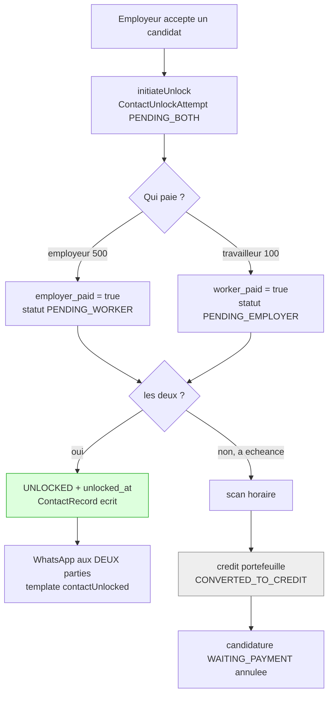

# Phase 1 — Cartographie de l'existant

Messagerie sanitisée entre profils, avant déblocage payant des coordonnées.

Ce document décrit **ce qui est**, pas ce qui devrait être. Toute affirmation est sourcée par un chemin de fichier et, quand c'est utile, un numéro de ligne. Les chemins sont relatifs à `rabotka-backend/` sauf mention contraire. Les suppositions sont préfixées `⚠️ HYPOTHÈSE` et regroupées en section 6.

---

## 0. Décision enregistrée avant analyse

La conversation vit **dans l'application** (option (b) de la section 2 du cahier des charges). WhatsApp ne sert qu'à notifier. Décision produit, actée, non rouverte ici. La section 7 en tire les conséquences.

---

## 1. Socle technique

| Élément | Réalité | Source |
|---|---|---|
| Framework | NestJS 11 sur Express 5, deux process : API (`src/main.ts`) et worker de files (`src/worker.ts`) | `package.json` |
| Langage | TypeScript, pnpm | `package.json` |
| ORM | Prisma 7 + `@prisma/adapter-pg`, PostgreSQL. Schéma unique de 2265 lignes, 113 migrations | `prisma/schema.prisma` |
| Cache / verrous | Redis (ioredis), `IdempotencyService` global (`SET NX EX`) | `src/common/services/idempotency/idempotency.service.ts:54-57` |
| Files | BullMQ via `QueueService` ; 15 files déclarées | `src/common/services/queue/queue.module.ts` |
| Temps réel | Socket.IO, adaptateur Redis **global** posé dans `main.ts` | `src/main.ts:191-194`, `src/common/adapters/redis-io.adapter.ts` |
| Validation | `ValidationPipe` global : `whitelist`, `forbidNonWhitelisted`, `transform` | `src/main.ts:73-82` |
| Anti-abus | Arcjet (`shield`, `detectBot`, `fixedWindow` 100/60 s) **et** `@nestjs/throttler` (100/60 s), les deux en `APP_GUARD` | `src/app.module.ts:91-124, 213-214` |
| CSRF | double-submit, réponse JSON 403 | `src/main.ts:88-110` |
| Tests | Jest, ~5000 tests, 304 suites | `package.json` |
| Préfixe API | `api/v1` | `src/main.ts:65-71` |

**Librairies déjà présentes et réutilisables ici :** `class-validator` / `class-transformer` (DTO), `zod` (config et schémas d'outils Vova), `nuqs` (côté admin), `fastembed` + Qdrant (embeddings), `prom-client` (métriques).

**Absents :** aucune librairie de sanitisation HTML (ni DOMPurify ni `sanitize-html`), aucun filtre de grossièretés, aucune librairie de détection de contenu, aucun paquet de normalisation Unicode dédié au-delà de `String.normalize`.

---

## 2. Inventaire fonctionnel

### 2.1 Identité et authentification — *réutilisable tel quel*

JWT porté par cookie (`readAuthCookie`) ou `Authorization: Bearer`, révocation par liste Redis sur `jti` (`src/modules/auth/guards/jwt-auth.guard.ts:87-93, 118-130`).

Forme du jeton (`jwt-auth.guard.ts:21-27`) : `{ sub, type?: 'profile' | 'admin', jti?, iat?, exp? }`. `sub` = `profileId` pour un profil, `userId` pour un admin ; `type` vaut `'profile'` par défaut quand il est absent (`:95`).

Trois gardes composables ; les deux dernières ne doivent jamais être posées sur un contrôleur entier (`active-profile.guard.ts:30-32`) :

- `ProfileAuthGuard` — `profile-auth.guard.ts:9-31`
- `ActiveProfileGuard` — `active-profile.guard.ts:35-59`, relit le profil à chaque requête, délibérément non caché
- `KycVerifiedGuard` — `kyc-verified.guard.ts:24-50`

Le lien compte ↔ numéro WhatsApp est `Profile.phone` (unique) ; la fenêtre de service de 24 h est dénormalisée dans `Profile.last_inbound_at` (`prisma/schema.prisma:476-490`).

### 2.2 Profils — *réutilisable tel quel*

`Profile` — `prisma/schema.prisma:406-565`. Un compte = un profil, discriminé par `profile_type` (`WORKER` | `EMPLOYER`). Coordonnées : `phone` (non nul, unique), `email` (nullable — l'onboarding est WhatsApp-first), `address`, `city`, `country_code`, `latitude` / `longitude`.

Métiers : **deux emplacements**, et la distinction compte — `category_id` (métier principal, souvent vide) et la table de jonction `profile_categories` (`ProfileCategory`, `schema.prisma:678+`), où vivent réellement les métiers choisis dans l'app.

### 2.3 Relations entre profils — *la question centrale du rattachement*

| Modèle | Lignes | Les deux profils sont-ils explicites ? | Candidat pour une conversation |
|---|---|---|---|
| `Application` | 877-932 | `worker_id` explicite ; employeur via `job_offer.employer_id` | **Oui** — une ligne vivante par (offre, travailleur), index partiel `applications_live_unique` (:916-922) |
| `Assignment` | 934-957 | idem | Oui, mais trop tard : n'existe qu'après acceptation |
| `ContactUnlockAttempt` | 959-990 | **`worker_id` et `employer_id`, tous deux colonnes** | **Oui** — déjà la paire payante, avec `status`, `expires_at`, `unlocked_at` |
| `ContactRecord` | 1017-1055 | **les deux explicites** | Oui, et seule table couvrant **les deux** chemins de déblocage. Sémantique de **grand livre** : une ligne par paiement, pas par paire (:1002-1016) ; index `idx_contact_record_pair` déjà présent (:1049) |
| `Rating` | 1925-1943 | les deux | Post-hoc uniquement (`assignment.status === COMPLETED`, `application.service.ts:1603-1605`) |
| `Referral` | 1150-1190 | les deux | Social, pas transactionnel |
| `SavedJob` | 714-725 | non | Non — l'employeur n'a consenti à rien |
| `InteractionEvent` | 736-783 | non (`counterparty_id` sans clé étrangère, :758) | Non — journal comportemental |

`CollaborationGraph` matérialise déjà la vue « paires ayant une vraie relation » (`src/modules/collaboration-graph/collaboration-graph.service.ts:24-30`, requête `src/common/queries/paid-contacts.sql.ts`).

### 2.4 Missions — *réutilisable tel quel*

`JobOffer` (`schema.prisma:789+`), statuts `ACTIVE | PARTIALLY_FILLED | FILLED | IN_PROGRESS | COMPLETED | CANCELLED | EXPIRED`, `employment_type` (`MISSION | CDD | CDI | STAGE`). Le terme *zakaz* **n'apparaît nulle part dans le code** — la correction est déjà consignée dans `src/modules/rag/docs/PROJECT_CONTEXT.md:217-220`.

### 2.5 Matching — *hors périmètre direct*

Moteur v2 + Qdrant + `InteractionGraph`. Un match **ne crée aucun objet persistant** entre deux profils : la sortie est un classement en mémoire (`src/modules/job-offer/notification/job-notification.service.ts:175-208`).

### 2.6 Paiement — *réutilisable, avec des angles morts à connaître*

Deux passerelles derrière un registre, une seule active par déploiement via `PAYMENT_GATEWAY_DRIVER` : Monetbil et MTN MoMo (`src/common/services/payment/payment-gateway.registry.ts:30-42`, `payment-gateway.factory.ts:16-28`).

`PaymentRequest` (`schema.prisma:1415-1454`), statuts `PENDING | PROCESSING | SUBMITTED | APPROVED | REJECTED` (:282-288).

**Idempotence : aucune clé d'idempotence.** Toute la protection repose sur des `updateMany` conditionnels suivis d'un test `count === 0` — revendication PENDING→PROCESSING (`payment-request.service.ts:283-292`), revendication APPROVED dans une transaction (`:662-682`), revendication atomique de `employer_paid` / `worker_paid` (`contact-unlock.service.ts:292-303`).

**Webhooks : aucune vérification de signature** sur `/webhooks/payment/callback` et `/webhooks/payment/mtn-momo` (`payment-request-public.controller.ts:56-78`). La défense est le rappel de l'API passerelle avant toute décision (`monetbil-payment.gateway.ts:126-127`, `mtn-momo-payment.gateway.ts:208-209`). À noter : le webhook **pénalités**, lui, est authentifié par secret partagé (`src/modules/payments/payment.webhook.controller.ts:26-29`).

**Remboursements en argent : ils n'existent pas.** `PaymentStatus.REFUNDED` est dans l'énumération (`schema.prisma:179`) et n'est **jamais écrit**. `refundProfileWallet` est un alias d'une ligne sur `creditProfileWallet` (`src/modules/wallet/wallet.service.ts:205-222`) : tout « remboursement » est un crédit de portefeuille.

### 2.7 Déblocage de contact — *le point le plus important*

**Deux chemins, de natures différentes.**

**Chemin A — mission (`ContactUnlockAttempt`) : réciproque, les deux paient.**
Créé à l'acceptation d'un candidat (`contact-unlock.service.ts:424-494`). Employeur 500 FCFA, travailleur 100 FCFA (`fees.contact_unlock_fee_employer` / `_worker`). Le statut ne passe `UNLOCKED` que si **les deux** ont payé (`:279-286`), et la révélation est alors **symétrique** : chacun reçoit les coordonnées de l'autre sur WhatsApp. Exception multi-postes : sur `quantity > 1`, l'employeur paie une fois pour toute l'offre (`:832-934`, garde `employer-coverage.ts:8-13`).

Expiration : min(48 h, `scheduled_at − 2 h`), plancher à +2 h (`:452-469`). Balayage horaire (`contact-unlock.scheduler.ts:15`). À l'expiration, les sommes versées deviennent du crédit de portefeuille et le statut passe `CONVERTED_TO_CREDIT` (`:1255-1370`).

**Chemin B — recommandation : unilatéral, l'employeur seul paie.**
`recommendation-contact.service.ts:40-45` — 1000 FCFA, **aucune ligne d'état n'est créée**. Le travailleur n'est ni consulté ni informé. L'appartenance est **reconstruite à chaque lecture** depuis les transactions de portefeuille et les demandes de paiement (`contacted-profiles.service.ts:67-108`, `src/common/queries/paid-contacts.sql.ts:35-56`).

**Quelle entité porte l'état « débloqué » :** `ContactUnlockAttempt.status === UNLOCKED` (ou `unlocked_at IS NOT NULL`), **et seulement pour le chemin A**. `ContactRecord` est le grand livre unifié des deux chemins mais **ne garde aujourd'hui aucun accès** : il n'est lu que par l'admin (`admin-contact-record.service.ts`).

**Le seul endroit qui laisse sortir un téléphone ou un email sur l'API profil :**
`GET /api/v1/profile/contacts` → `ContactedProfilesService.listContacts` (`profile.controller.ts:76-89`, `contacted-profiles.service.ts:122-188`). Réservé aux employeurs (:123-130), construit l'ensemble des `workerIds` payés, puis sélectionne avec `CONTACT_PROFILE_SELECT` qui contient `phone` et `email` (:33-47). C'est une garde **par appartenance à un ensemble**, pas une vérification ligne à ligne — le docstring le dit (:117-121).

`ContactUnlockService.getContactsIfUnlocked` (`:1190-1216`) fait la vérification propre dans les deux sens, mais **n'a aucun appelant HTTP** : c'est une surface d'API morte.

Les endpoints REST de déblocage **ne renvoient jamais les coordonnées** — commentaires explicites en `mobile-application.controller.ts:313-317` et `mobile-worker-mission.controller.ts:186-188`. La livraison est exclusivement WhatsApp.



### 2.8 Permissions — *réutilisable, mais rien de générique*

**Aucun décorateur ni intercepteur de propriété.** Chaque contrôleur réécrit la vérification à la main : `getOwnedAttempt` + `assertEmployer` (`mobile-application.controller.ts:320-350`), `requireOwnedAttempt` / `assertWorker` (`mobile-worker-mission.controller.ts`), puis **re-vérification au niveau service** (`contact-unlock.service.ts:206-218`, `recommendation-contact.service.ts:241-262`). La convention est écrite noir sur blanc : garder à la route **et** ré-affirmer dans le service.

Côté admin : `AdminAuthGuard` + `RolesGuard` + `@Roles`, plus une liste blanche latérale indexée sur le préfixe `@Controller()` (`lateral-access.ts:32-124`) — **tout ce qui n'y figure pas est refusé**, donc un nouveau contrôleur admin est fermé par défaut à FINANCE et SUPPORT.

**Aucune limite de débit par route sur les endpoints de déblocage ou de contact** — seulement le plafond global de 100/min.

### 2.9 API — *conventions claires*

Préfixe `api/v1`. Profil : `@Controller('profile')` + `@UseGuards(ProfileAuthGuard)`, sous-espaces `profile/wallet`, `profile/applications`, `profile/worker/missions`. Admin : `admin/<domaine>`.

Pas d'enveloppe de réponse : les handlers renvoient `{ application }`, `{ token }`, `{ ok: true }`. Erreurs = exceptions Nest en français. Pagination `{ data, total, page, limit }`, `page` à base 1, `limit` par défaut 10 / max 100 — **aucun DTO de pagination partagé** (`src/common/dto/` ne contient que `bulk-delete.dto.ts` et `location.dto.ts`) ; le modèle canonique est `contact-unlock/dto/admin-list-contact-records.dto.ts:27-93`.

### 2.10 Services backend — *réutilisable tel quel*

Découpage contrôleur / service / Prisma direct (pas de couche repository). Injection Nest classique, transactions via `prisma.$transaction`, journalisation via `LogService`, cache de listes admin via `AdminCacheService.wrap(...)`.

### 2.11 Événements et notifications — *réutilisable tel quel, et c'est un point fort*

Bus `EventEmitter2` (wildcard). Point d'entrée unique pour la cloche in-app : `notifyProfile(events, { recipientId, input, actorId?, dedupeKey?, dedupeTtlSeconds? })` — `profile-notification.events.ts:16-26`, feu-et-oubli, avale les erreurs. Rendu centralisé dans `notification-catalog.ts` (union discriminée `NotificationInput`, :35-115).

**Ajouter un type impose** : membre d'énumération Prisma + migration, variante de l'union, `case` dans le rendu, et une livraison client (commentaire de schéma `:1631-1632`).

WhatsApp : registre de ~35 modèles (`src/common/constants/whatsapp-templates.ts`) et surtout `NotificationDispatcher.send(...)` (`src/modules/notification-dispatch/notification-dispatcher.service.ts:100`), qui envoie en texte libre **gratuit** si la fenêtre de 24 h est ouverte et retombe sur le modèle approuvé sinon. `openWindows(profileIds)` répond pour un lot entier en une requête (`whatsapp.service.ts:680`).

### 2.12 Temps réel — *le maillon faible pour cette fonctionnalité*

Huit passerelles, toutes adossées à Redis par l'adaptateur global.

| Namespace | Auth | Sens | Fichier |
|---|---|---|---|
| `/chat` | JWT **admin uniquement** (`type !== 'admin'` rejeté) | bidirectionnel, persiste | `chat.gateway.ts:104` |
| `/notifications` | JWT profil | **push seul** | `profile-notifications.gateway.ts:73` |
| `/job-events` | JWT profil | **push seul** | `job-events.gateway.ts:107` |
| `/ad-inbox` | JWT profil | **push seul** | `ad-inbox.gateway.ts` |
| `/admin-notifications` | JWT admin | push | `ws-notifications.gateway.ts:89` |
| `/qr`, `/claim-comments`, `/payment-status` | **aucune** | push, room fournie par le client | `qr.gateway.ts`, `claim-comments.gateway.ts`, `payment-status.gateway.ts` |

**Aucune passerelle authentifiée côté profil ne déclare de `@SubscribeMessage`** : un client profil n'a aujourd'hui aucun moyen d'émettre quoi que ce soit. Convention de room `profile:{profileId}` partagée par trois passerelles, dérivée du JWT et jamais du client (`profile-notifications.gateway.ts:16-19`).

Le module chat est **admin-only jusque dans le schéma** : `ChatParticipant.user_id → User`, `ChatMessage.sender_id → User` (`schema.prisma:1969-2001`). Le modèle `Profile` n'a **aucune** relation vers ces trois tables.

Deux observations à verser au dossier : toutes les passerelles acceptent **toutes** les origines CORS ; et `WsNotificationsGateway.afterInit` repose un second adaptateur Redis sur le serveur racine, par-dessus celui de `main.ts` (`ws-notifications.gateway.ts:49-69`).

### 2.13 WhatsApp — *réutilisable pour la notification uniquement*

API Cloud Meta active (`WHATSAPP_PROVIDER=cloud`), Twilio conservé derrière la même interface. **Un seul numéro d'envoi** (`WHATSAPP_CLOUD_PHONE_NUMBER_ID`, `whatsapp.config.ts:49`) — en relais, le destinataire verrait donc le numéro de Rabotka, jamais celui de l'expéditeur. Point désormais sans objet puisque la conversation est in-app.

Entrant : webhook → dédoublonnage Redis → `whatsapp-inbound-queue` → routeur bot → Vova. Sortant : `whatsapp-outbound-queue` avec DLQ, et envois directs hors file pour les notifications de cycle de vie.

### 2.14 Administration — *conventions solides, à suivre sans les réinventer*

Rôles (`schema.prisma:24-31`) : `SUPER_ADMIN`, `ADMIN`, `MANAGER`, `MODERATOR`, plus les latéraux `FINANCE` et `SUPPORT`. Hiérarchie `MODERATOR:1 < MANAGER:2 < ADMIN:3 < SUPER_ADMIN:4` (`role-seniority.ts:16-21`).

**Un rôle MODERATOR existe déjà** et constitue le premier barreau : 53 handlers sont en `@Roles(UserRole.MODERATOR)`. Il ne peut **pas** changer le statut d'un compte (`admin-profile.controller.ts:961`, MANAGER) ni lire le journal d'audit (`log/log.controller.ts:29`, MANAGER).

Audit : `LogService.create({ action, entityType, entityId, userId, profileId, metadata, ...extractRequestMeta(req) })`, table `Log` (`schema.prisma:1214-1226`), ~101 appels. Convention d'action en `SCREAMING_SNAKE`. L'admin humanise les codes via `rabotka-admin/src/lib/log-labels.ts` — un nouveau code d'action s'affiche proprement sans modification, mais un nouveau `entityType` doit être ajouté à `RECORD_TYPES`.

Recette d'un nouvel écran de liste : route de fichier → page (`PageListHeader` + `DataTable`) → barre d'outils (`TableHeaderToolbar` avec filtres) → hook `use-<domaine>-list.ts` (parseurs **nuqs**, l'URL est la source de vérité) → client d'API → dossier `features/<domaine>/` → entrée de barre latérale (`app-sidebar.tsx`) → **et** ajout du préfixe dans `LATERAL_ACCESS` côté backend et `LATERAL_ROUTES` côté admin, faute de quoi la page s'affiche et toutes ses requêtes répondent 403.

### 2.15 Vova AI — *la brique imposée : ce qu'elle vaut réellement*

**Mode d'appel : synchrone, à l'intérieur d'un job BullMQ.** Chaîne complète : webhook → `whatsapp-inbound-queue` (concurrence 5) → `conversation.service.ts:43` → `bot-orchestrator` → `vova.service.ts:245` → `agent.service.ts:851` → `llm.service.ts:309`. **Il n'existe pas de file LLM séparée** : l'appel bloque le job pour tout le tour.

Budgets (`llm.service.ts`, `vova.constants.ts`) :

| Paramètre | Défaut | Rôle |
|---|---|---|
| `vova.timeout_ms` | **25 000 ms** | budget du tour entier |
| `VOVA_LLM_TIMEOUT_MS` | **12 000 ms** | plafond par appel |
| `VOVA_FALLBACK_RESERVE_MS` | **7 000 ms** | réserve gardée tant qu'il reste un successeur |
| `VOVA_LLM_MIN_CALL_MS` | **1 500 ms** | plancher : en dessous, on ne facture pas un appel condamné (`:184-199`) |
| `VOVA_LLM_RETRY_BACKOFF_MS` | 250 ms | une seule reprise sur place |

Chaîne `standard` (`models.config.ts:103-158`) : `gpt-4o-mini` → `gemini-flash-lite` → `claude-haiku-4-5` → `gemini-3.6-flash` → `mistral-small` → `llama-3.3-70b` → `deepseek-chat`. Disjoncteur Redis par `provider:model` (5 échecs / 120 s, refroidissement 60 s — `breaker.service.ts:51-53`), **qui échoue en position « sain »** si Redis tombe.

**Comportement quand tout échoue** : `LlmChainExhaustedError` → capté dans `agent.service.ts:1040-1050` → refus canné → `vova.service.ts` renvoie `null` → **le bot envoie sa carte statique**. L'utilisateur ne voit jamais d'erreur.

Latence, telle qu'écrite dans le code : « 6,5 s de moyenne en production » (`vova.service.ts:384-390`), `gemini-flash-lite` ~1,4 s médian contre ~10 s pour `gemini-3.6-flash` (`models.config.ts:34-35`), incident documenté à 20 007 ms (`:52-55`).

**Sortie structurée : elle n'existe nulle part.** Aucune occurrence de `withStructuredOutput`, `responseFormat`, `json_schema` ni `response_mime_type` dans tout le dépôt. `FallbackChatModel` ne surcharge que `bindTools` et `_generate` (`agent/fallback-chat-model.ts:69-120`).

**Comptabilité de coût : jetons oui, argent non.** `readUsage()` remonte `input_tokens` / `output_tokens` / `cache_read` (`llm.service.ts:596-601`) et les expose en Prometheus (`llm/metrics.ts:95-103`). **Aucune table de prix, aucun montant, aucun registre de dépense par profil.** Le contrôle des coûts se fait par quota (`vova.anon_daily_limit`, `vova.walled_daily_limit`).

Cache réutilisable : mise en cache de prompt **uniquement chez Anthropic** (`markCacheBreakpoint`, `models.config.ts:194-196`) ; mémoïsation par tour des appels de service (`tool-deps.provider.ts:121-160`) ; **embeddings de catégories mis en cache avec TTL et similarité cosinus** (`intents/job-category.registry.ts`, `intents/category-similarity.ts`) — c'est l'objet le plus proche d'un classifieur existant. Les embeddings de requête, eux, ne sont pas mis en cache.

**Confidentialité — ce qui part chez le fournisseur aujourd'hui** (`agent.service.ts:950-974`) : le **prénom**, le type de profil, le statut KYC et le statut de compte ; les **faits mémorisés** ; les **6 derniers tours** de conversation WhatsApp bruts sur une fenêtre de 4 h (`history.service.ts:26-45`) ; le message courant ; les résultats d'outils, qui incluent `rejectionReason` et `suspensionReason` (`intents/dto.ts:25+`). **Aucune anonymisation, aucun hachage, aucune pseudonymisation.** Le numéro de téléphone, lui, n'est jamais dans le prompt. La chaîne `standard` répartit tout cela sur six fournisseurs aux États-Unis et en Europe.

Un garde-fou d'injection existe, lexical et déterministe : `classifyIdentityQuery` traite « ignore les instructions précédentes » (`agent/identity.ts`), et le modèle **n'a aucun outil d'écriture** (`agent/read-only.ts`).

### 2.16 Modération existante — *une base, mais pas là où il faudrait*

**Ce qui existe :** suspension / bannissement de compte (`PATCH /admin/profiles/:id/status`, MANAGER) ; les réclamations comme canal de signalement, y compris ouvertes **sur** quelqu'un (`claim.service.ts:759`) ; un signalement automatique d'abus déposé par le pipeline après 3 messages abusifs (`agent/abuse-report.service.ts`, seuil `guard.service.ts:271`) ; pénalités ; suppression douce / restauration / purge.

**`GuardService` est la seule détection de coordonnées du dépôt** (`agent/guard.service.ts:17-23`) :

```ts
const PHONE_PATTERNS = [
  ['phone_intl',  /\+\s?\d{1,3}[\s.-]?(?:\d[\s.-]?){7,}/],
  ['phone_local', /\b0\d[\s.-]?(?:\d[\s.-]?){6,}\d\b/],
  ['phone_bare',  /\b\d{8,}\b/],
];
const EMAIL_PATTERN = /[\w.+-]+@[\w-]+\.[\w.]{2,}/;
```

Avec une liste de formulations de contournement en entrée (`CONTACT_REQUEST_PATTERNS`, :103-131 — « son numero », « sans passer par rabotka », « sans payer le deblocage »).

**Trois limites décisives, à retenir pour la Phase 2 :**

1. **Tout ou rien** — sur détection, `sanitize` remplace **la réponse entière** par un refus (`:433-445`) et ne renvoie que des étiquettes. Il n'y a **aucune position, aucun offset**.
2. **Portée** — cela ne tourne que sur les réponses de VoVa. Aucun écrit d'utilisateur ne passe par là.
3. **Non configurable** — les motifs sont des `const` en dur : ni en base, ni dans `SystemConfig`, ni éditables depuis le back-office.

**Ce qui n'existe pas :** aucune liste noire en base, aucune fonctionnalité de signalement côté utilisateur (pas de bouton, pas de modèle `Report`), aucune file de modération distincte du kanban des réclamations, aucun appel LLM de classification (`router.service.ts:40-44` l'interdit même explicitement), aucun écran admin pour Vova.

### 2.17 Champs libres — *le trou dans la raquette*

**Aucun champ libre saisi par un utilisateur n'est filtré aujourd'hui.** Au mieux un `trim()`, et parfois une borne de longueur.

| Champ | Borne | Filtrage | Source |
|---|---|---|---|
| `Profile.description` (création) | **aucune** | aucun | `profile/dto/create-profile.dto.ts:77-81` |
| `Profile.description` (mise à jour) | 500 | aucun | `profile/dto/update-profile.dto.ts:30-35` |
| `JobOffer.title` | 5–100 | aucun | `job-offer/dto/create-job-offer.dto.ts:19-23` |
| `JobOffer.description` | 20–1000 | aucun | `:25-34` |
| `JobOffer.address` | min 10, **pas de max** | aucun | `:73-82` |
| `JobOffer.note` | 500 | aucun | `:92-96` |
| `PortfolioItem.description` | 1000 | aucun, **et page publique non authentifiée** | `portfolio/dto/create-portfolio-item.dto.ts:6-15`, `portfolio.service.ts:443-450` |
| `Claim.title` / `description` | min 1, **pas de max**, `@db.Text` | aucun | `claim/dto/create-claim.dto.ts:14-22` |
| `ClaimComment.content` | 1–5000 | aucun, diffusé sur une passerelle **non authentifiée** | `claim/dto/create-comment.dto.ts:27-35` |
| `Feedback.comment` | **aucune** (webhook, sans DTO) | aucun | `whatsapp/feedback/whatsapp-feedback.service.ts:110-116` |

`Rating` n'a **pas** de champ commentaire (`schema.prisma:1925-1943`) : seulement un score entier de 1 à 5.

### 2.18 Observabilité et conformité

Prometheus (`prom-client`), journal `vova.llm` structuré (`llm.service.ts:642-679`), compteurs WhatsApp (`whatsapp/telemetry/metrics.ts`). Masquage : `maskPhone` existe mais sert aux claims OAuth et aux lignes de journal, jamais au déblocage (`oauth/utils/claims.util.ts:32`, `whatsapp.service.ts:940`).

Rétention : purge des journaux WhatsApp à 180 jours (`whatsapp-admin/whatsapp-log-retention.service.ts`, `30 3 * * *`). **Aucun chiffrement applicatif au repos** sur les contenus. Interdiction de catégories particulières inscrite dans le prompt mémoire (`memory.service.ts:229-230`).

---

## 3. Points d'intégration

### 3.1 Abstractions réutilisables

| Brique | Chemin | Usage pour la messagerie |
|---|---|---|
| `ProfileAuthGuard` / `ActiveProfileGuard` | `auth/guards/` | garder les routes de conversation |
| Convention room `profile:{id}` | `profile-notifications.gateway.ts:16-19` | diffusion d'un message à son destinataire |
| Adaptateur Redis Socket.IO | `common/adapters/redis-io.adapter.ts` | déjà global, rien à ajouter |
| `notifyProfile` + catalogue | `profile-notification/` | cloche « nouveau message » |
| `NotificationDispatcher` | `notification-dispatch/` | notification WhatsApp au coût minimal |
| `ContactUnlockAttempt.status` | `contact-unlock.service.ts` | **l'état de déblocage existe déjà, ne pas le dupliquer** |
| `LogService` | `log/log.service.ts` | audit des consultations admin |
| `IdempotencyService` | `common/services/idempotency/` | dédoublonnage |
| Motifs de `GuardService` | `rag/agent/guard.service.ts:17-23` | point de départ des règles déterministes |
| `foldText` | `rag/shared/text.ts:1-9` | normalisation — **mais destructive, voir section 4** |
| Registre d'embeddings de catégories | `rag/intents/job-category.registry.ts` | modèle d'un classifieur peu coûteux |
| Recette d'écran admin | `rabotka-admin/src/pages/jobs.tsx`, `hooks/use-jobs-list.ts` | module Conversations |
| Compteur de non-lus | `rabotka-client/src/features/notifications/` (`notification-bell.tsx`, `read-state.ts`) | pastille de l'onglet Discussion |

### 3.2 Fichiers qui seront touchés

| Fichier | Nature de l'impact |
|---|---|
| `prisma/schema.prisma` + migration | nouvelles entités conversation / message / détections ; **aucun nouvel état de déblocage** |
| `src/modules/chat/*` | **décision à trancher en Phase 2** : étendre aux profils, ou laisser intact et créer à côté |
| nouvelle passerelle, ou extension d'une existante | seul moyen d'émettre depuis un client profil |
| `profile-notification/notification-catalog.ts` + enum Prisma | type « nouveau message » |
| `auth/guards/lateral-access.ts` | ouvrir le module admin aux rôles latéraux, ou le laisser fermé |
| `rabotka-admin` : route, page, hook, feature, `app-sidebar.tsx`, `lib/role-access.ts` | module Conversations |
| `rabotka-client` : `features/navigation/config/tabs.tsx`, `pages/profile.tsx`, nouvelle route | onglet Discussion (voir 7.5) |
| `contact-unlock.service.ts` | lecture de l'état, éventuel point d'accroche à l'ouverture de conversation |

### 3.3 Ce qui n'existe pas et devra être créé

1. **Toute conversation profil ↔ profil** : modèle, service, endpoints, temps réel montant.
2. **Une normalisation conservant les positions** — `foldText` est destructive.
3. **Une détection renvoyant des offsets et des catégories**, là où `GuardService` ne renvoie que des étiquettes.
4. **Un rendu différencié** expéditeur / destinataire.
5. **Une classification sémantique** : ni sortie structurée, ni JSON mode, ni appel LLM de classification n'existent.
6. **Un signalement de faux positif** côté utilisateur.
7. **Un module admin Conversations**, avec séparation entre lecture des métadonnées et lecture du contenu.
8. **Une comptabilité de coût LLM en argent**, si le budget doit être piloté.
9. **Une sanitisation des champs libres existants**, sans quoi la messagerie est contournable en une ligne de bio.

---

## 4. Le piège des offsets, confirmé dans le code

`foldText` (`rag/shared/text.ts:1-9`) enchaîne : `normalize('NFD')` → suppression des diacritiques → `toLowerCase()` → remplacement de **toute** ponctuation par une espace → écrasement des espaces → `trim()`.

Chacune de ces étapes **change les longueurs**. Des offsets calculés sur le texte normalisé ne peuvent donc pas être reportés sur l'original : c'est exactement le risque décrit au point 3.1 du cahier des charges, et il est ici mesurable plutôt que théorique. La Phase 2 devra proposer une normalisation conservant une table de correspondance position à position.

---

## 5. Hors périmètre — observations

Relevées en passant, non traitées ici :

1. `PaymentRequest.contact_unlock_attempt_id` : **ni clé étrangère ni index**.
2. Un paiement encaissé dont le post-traitement échoue est **avalé** (`payment-request.service.ts:1013-1019`) : l'argent est gardé, rien ne réessaie.
3. `RecommendationContactService.payWithWallet` fait un lire-puis-écrire sur le solde (`:76-80`) au lieu de la garde atomique `gte` de `debitProfileWallet` (`:230-238`) — deux requêtes simultanées peuvent passer.
4. Les statuts `PENDING_EMPLOYER` / `PENDING_WORKER` nomment **celui qui doit encore payer**, à l'inverse de la lecture spontanée.
5. `chat.gateway.ts:116-121` : le corps d'un message envoyé par socket n'est validé par **aucun** DTO — les bornes de `SendMessageDto` ne s'appliquent qu'en REST.
6. `getMessages` ne filtre pas `deleted_at` (`chat.service.ts:429`) : les messages supprimés restent dans l'historique.
7. Trois passerelles sont **non authentifiées** avec une room fournie par le client (`/qr`, `/claim-comments`, `/payment-status`) : qui devine un UUID de réclamation reçoit tous ses commentaires.
8. Toutes les passerelles acceptent toutes les origines CORS.
9. `getContactsIfUnlocked` est du code mort en tant que surface d'API.

---

## 6. Hypothèses à valider

- ⚠️ **HYPOTHÈSE** — le volume de messages attendu n'est déductible d'aucune donnée du dépôt. Tout dimensionnement de coût LLM en Phase 2 sera donc paramétré, pas chiffré.
- ⚠️ **HYPOTHÈSE** — « 6,5 s de moyenne » est une mesure **écrite dans un commentaire** (`vova.service.ts:384-390`), pas une métrique observée. À confirmer sur Prometheus avant d'en faire un budget.
- ⚠️ **HYPOTHÈSE** — les préfixes opérateurs congolais ne figurent nulle part dans le code ; les motifs actuels sont génériques. À établir depuis une source externe et à placer en configuration, comme le demande le cahier des charges.
- ⚠️ **HYPOTHÈSE** — l'envoi de messages privés à six fournisseurs tiers est probablement à mentionner dans les CGU ; je n'ai pas lu les CGU, je ne peux que signaler la question.

---

## 7. Réponse à la section 2 — où vit la conversation

**Tranché par le produit : in-app (option b).** Conséquences factuelles :

1. **Le coût par message Meta disparaît** pour la conversation. Ne subsiste que la notification, et `NotificationDispatcher` l'envoie gratuitement quand la fenêtre de 24 h est ouverte.
2. **La modération peut être synchrone dans la requête HTTP d'envoi.** Pas d'aller-retour Meta à doubler ; le budget latence est celui d'une requête, pas d'un tour de bot.
3. **Le temps réel devient le point dur.** Les trois passerelles profil sont en push seul ; `/chat` est bidirectionnel mais rejette tout jeton non-admin et son schéma ne connaît que `User`. Réutiliser ou ajouter est le vrai arbitrage de la Phase 2.
4. La question « les deux parties voient-elles le numéro de l'autre » est **sans objet**.

### 7.5 L'onglet Discussion dans le menu du bas

Décidé par le produit : la messagerie a son propre onglet dans la barre du bas de `rabotka-client`, **par remplacement et non par ajout** — les barres restent à cinq entrées.

État actuel (`rabotka-client/src/features/navigation/config/tabs.tsx:19-32`) :

| Rôle | Onglets actuels |
|---|---|
| Travailleur | Accueil · Candidatures · Missions · Réclamations · Profil |
| Employeur | Accueil · Mes offres · Candidatures · Missions · Profil |

Changement décidé :

| Rôle | Onglet retiré | Devient | Destination du retiré |
|---|---|---|---|
| Travailleur | Réclamations | **Discussion** | menu Profil |
| Employeur | Missions | **Discussion** | menu Profil |

Coût réel du déplacement, vérifié :

- **Côté travailleur, il est nul.** `/claims` est **déjà** une ligne du menu Profil (`rabotka-client/src/pages/profile.tsx:299`). Retirer l'onglet ne retire aucun accès : il suffit de supprimer l'entrée de `WORKER_TABS`.
- **Côté employeur, une ligne est à ajouter.** Le menu Profil liste aujourd'hui Portfolio (:263), Tableau de bord (:275), Profils contactés (:287), Réclamations (:299), Portefeuille (:307) et Support (:310) — **`/missions` n'y figure pas**. Sans cet ajout, le déplacement supprime un accès au lieu de le déplacer.

La barre est un `flex` avec `flex-1` par entrée (`components/bottom-nav.tsx:27-31`) : le remplacement ne change donc rien à la mise en page. Côté employeur, `/missions` et `/candidatures` sont deux vues proches et l'onglet Candidatures reste dans la barre, ce qui limite la perte de visibilité.

---

## Vérifications à faire avant la Phase 2

1. Confirmer sur Prometheus la latence réelle de `vova.llm` — la valeur retenue ici vient d'un commentaire, pas d'une mesure.
2. Fournir le volume de messages attendu par mise en relation : c'est la seule entrée manquante pour chiffrer le coût de la couche sémantique au lieu de le paramétrer.
3. Trancher, en Phase 2, entre étendre `src/modules/chat/` aux profils et créer des tables dédiées — avec la comparaison « réutiliser / ajouter » exigée par la règle 5 du cahier des charges.
