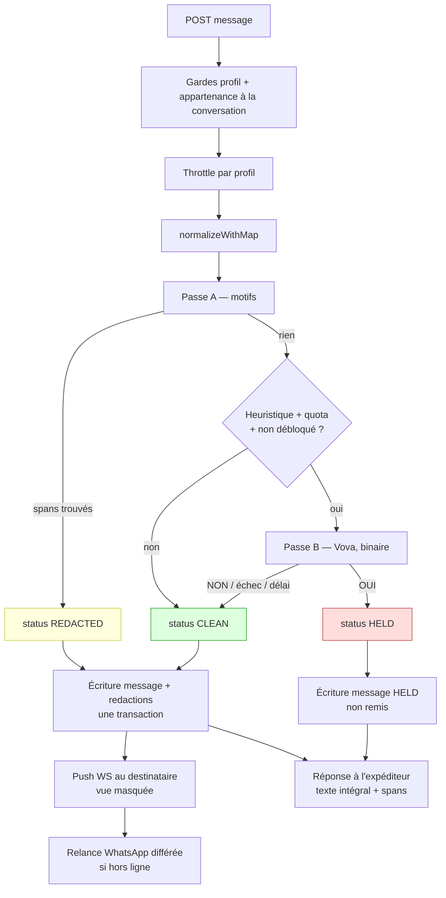

# Phase 2 — Architecture

Suite de [`01-existant.md`](./01-existant.md). Tous les chemins sont relatifs à `rabotka-backend/` sauf mention contraire.

Ce document **décide**. Chaque décision porte son coût et son alternative rejetée. Rien n'a été modifié dans le code.

---

## 0. Les huit décisions, en une page

| # | Question | Décision | Fondement |
|---|---|---|---|
| D1 | Étendre `/chat` ou créer ? | **Créer `profile-chat`**, ne pas toucher `/chat` | `ChatParticipant.user_id` et `ChatMessage.sender_id` pointent sur `User` (`schema.prisma:1969-2001`) : les rendre polymorphes est une refonte, interdite |
| D2 | Transport d'envoi | **REST pour envoyer, WebSocket pour recevoir** | La modération doit rendre un verdict structuré à l'expéditeur : c'est une requête/réponse. Et le `ValidationPipe` global (`main.ts:73-82`) ne tourne pas sur les passerelles — `chat.gateway.ts:116-121` en est la démonstration |
| D3 | Sur quoi s'accroche une conversation | **`Application`**, via une colonne nullable | C'est le seul objet où les deux parties ont consenti avant tout paiement (`schema.prisma:877-932`) ; nullable laisse entrer le chemin recommandation plus tard sans migration |
| D4 | État « débloqué » | **Jamais dupliqué**, lu depuis `ContactUnlockAttempt` | `contact-unlock.service.ts:279-286` ; deux sources de vérité sur un état payant, c'est un litige garanti |
| D5 | Normalisation | **Nouvelle fonction à table de positions**, `foldText` intouché | `rag/shared/text.ts:1-9` est destructive en quatre endroits ; elle a des appelants qui en dépendent |
| D6 | Détection | **Deux passes : déterministe toujours, sémantique sous condition** | La passe A donne les offsets, la passe B donne un booléen — voir D7 pour pourquoi elle ne peut pas donner mieux |
| D7 | Rôle exact de Vova AI | **Question binaire, pas d'offsets** | Aucune sortie structurée n'existe dans le dépôt (§2.15 de la Phase 1) : `withStructuredOutput`, `json_schema`, `response_mime_type` → zéro occurrence |
| D8 | Notification d'un nouveau message | **Aucun nouveau type de notification in-app** | Un message = une ligne de feed serait du bruit ; le badge vient du compteur de non-lus, et la relance WhatsApp est différée et groupée |

---

## 1. Frontière du module

Un module Nest, `src/modules/profile-chat/`, qui **ne sait rien** du paiement et **tout** de la conversation. Il lit l'état de déblocage ; il ne l'écrit jamais.

```
src/modules/profile-chat/
├── profile-chat.module.ts
├── profile-chat.controller.ts        # profil : envoi, lecture, signalement
├── profile-chat.service.ts           # conversation, messages, non-lus
├── profile-chat.gateway.ts           # push seul, room profile:{id}
├── admin-profile-chat.controller.ts  # back-office (D11)
├── admin-profile-chat.service.ts
├── moderation/
│   ├── normalize.ts                  # D5 — table de positions
│   ├── patterns.ts                   # D6 passe A — motifs + offsets
│   ├── semantic.ts                   # D7 passe B — appel Vova
│   ├── redact.ts                     # rendu masqué à partir des spans
│   └── moderation.service.ts         # orchestration des deux passes
└── dto/
```

`moderation/` ne dépend d'aucun service du module : ce sont des fonctions pures plus un service qui appelle `LlmService`. C'est délibéré — c'est le seul endroit testable exhaustivement, et c'est le seul endroit dont une erreur coûte de l'argent réel à Rabotka.

### Pourquoi pas dans `rag/agent/` à côté de `GuardService`

`GuardService` protège **les sorties du modèle**. Ici on protège **les entrées des utilisateurs**. Les deux partagent des motifs, pas un cycle de vie : les motifs de `guard.service.ts:17-23` deviendront une constante exportée réutilisée des deux côtés, et rien de plus. Mettre la modération des utilisateurs dans `rag/` la ferait dépendre du module RAG entier pour une regex.

---

## 2. Modèle de données

Trois tables. Conventions du dépôt respectées : `PascalCase` de modèle, colonnes `snake_case`, `@db.Uuid`, `@@map` au pluriel.

### 2.1 `ProfileConversation` → `profile_conversations`

Deux participants **en colonnes explicites**, pas de table de jonction.

Justification : ici une conversation a toujours exactement deux parties, et elles ont des rôles asymétriques (l'un est travailleur, l'autre employeur, les tarifs de déblocage diffèrent — 100 vs 500 FCFA, `contact-unlock.service.ts:424-494`). Une table de jonction autoriserait des états que le domaine interdit : trois participants, deux travailleurs, un participant retiré. C'est exactement la forme retenue par `ContactUnlockAttempt` (`schema.prisma:959-990`), et suivre la convention existante vaut mieux qu'imiter `ChatParticipant`, dont la généricité sert un vrai besoin (salons d'équipe, `is_team`) que la messagerie n'a pas.

Champs :

- `worker_id`, `employer_id` → `Profile`, tous deux `onDelete: Cascade`
- `application_id` → `Application`, **nullable et unique**
- `last_message_at` — dénormalisé, sinon trier la liste des conversations impose un `ORDER BY` sur une agrégation de `profile_messages` à chaque ouverture de l'onglet
- `worker_last_read_at`, `employer_last_read_at` — deux colonnes plutôt qu'une table de lecture, pour la même raison qu'en 2.1 : deux participants, jamais plus
- `closed_at` — nullable ; voir §3.3
- pas de colonne d'état de déblocage (D4)

Index : `[worker_id, last_message_at]`, `[employer_id, last_message_at]` — les deux requêtes de liste. `@@unique([application_id])` porte la règle « une candidature, une conversation ».

**La colonne nullable `application_id` est le point à ne pas rater.** Le chemin recommandation (`recommendation-contact.service.ts:40-45`) ne crée aucune ligne d'état : il n'y a pas d'`Application`. Ce chemin est hors périmètre v1, mais la colonne nullable fait que l'y ajouter coûtera un service, pas une migration sur une table pleine.

### 2.2 `ProfileMessage` → `profile_messages`

- `conversation_id`, `sender_id`
- `body` — **le texte original, tel que tapé**
- `moderation_status` — enum, voir 2.4
- `semantic_flagged Boolean @default(false)` — la passe B a répondu oui sans que la passe A trouve d'offset
- `created_at`, `read_at`, `deleted_at`

Index : `[conversation_id, created_at]`.

**Le corps stocké est l'original, jamais la version masquée.** Trois raisons, dans l'ordre d'importance :

1. La décision produit 3.1 exige que l'expéditeur voie **exactement** quels fragments ont été retenus. Sans l'original et les positions, c'est impossible.
2. Un faux positif signalé n'est instruisable que si l'admin peut lire ce qui a réellement été tapé.
3. Stocker la version masquée rend la correction d'un motif trop large rétroactivement impossible : les messages déjà censurés le resteraient.

Le prix de ces trois raisons est réel et doit être dit : **les numéros de téléphone échangés en fraude sont en clair dans la base.** Il n'y a pas de chiffrement applicatif au repos dans ce dépôt (Phase 1 §2.18). Les contre-mesures sont en §7.

### 2.3 `MessageRedaction` → `message_redactions`

Une ligne par fragment retenu.

- `message_id` → `ProfileMessage`, `onDelete: Cascade`
- `start_offset`, `end_offset` — `Int`, **positions dans `ProfileMessage.body`**, bornes demi-ouvertes `[start, end)`
- `category` — enum, voir 2.4
- `matched_by` — l'identifiant du motif qui a déclenché (`phone_intl`, `operator_prefix_congo`, …). C'est ce champ qui permet de dire « ce motif produit 40 % des faux positifs » sans relire les messages.

Index : `[message_id]`.

Les offsets sont dans l'original, **pas** dans le texte normalisé. C'est tout l'objet de D5 et de §4.

### 2.4 Énumérations

```
MessageModerationStatus : CLEAN | REDACTED | HELD
```

- `CLEAN` — rien détecté, le destinataire voit le texte intégral
- `REDACTED` — la passe A a trouvé des fragments ; le destinataire voit le texte avec les trous
- `HELD` — **le message n'est pas remis**. Deux cas seulement : la passe B a répondu oui sans offset exploitable (D7), ou le message est majoritairement composé de fragments retenus (seuil en config)

```
RedactionCategory : PHONE | EMAIL | MESSAGING_HANDLE | URL | OBFUSCATED_DIGITS
```

`OBFUSCATED_DIGITS` couvre « zéro six quarante », « O6 » avec la lettre O, les chiffres espacés. Catégorie distincte de `PHONE` parce que son taux de faux positifs sera structurellement plus élevé et qu'il faudra pouvoir la désactiver seule.

### 2.5 `RedactionReport` → `redaction_reports`

Signalement de faux positif par l'expéditeur : `message_id`, `reporter_id`, `note` (bornée), `created_at`, `reviewed_at`, `reviewed_by`, `verdict`.

**Pourquoi pas une `Claim`**, alors que les réclamations sont déjà le canal de signalement du produit (`claim.service.ts:759`) : une réclamation ouvre une carte de kanban et engage le délai de traitement du support. Ici la valeur n'est pas de traiter un cas, c'est d'**accumuler un corpus** de faux positifs pour régler les motifs. Un fil de réclamation ne s'agrège pas ; une table avec `matched_by` en jointure se compte en une requête. Si un signalement révèle un vrai litige, le support ouvre une réclamation à la main — c'est déjà son métier.

### 2.6 Ce qu'on n'ajoute pas

- **Aucune pièce jointe.** `ChatMessage.attachments` existe côté admin (`schema.prisma:1988`) ; ici une image est un canal d'exfiltration trivial (une photo d'un numéro écrit à la main) que rien dans ce dépôt ne sait lire. Hors périmètre, et à dire au produit plutôt qu'à découvrir en production.
- **Aucun membre de `ProfileNotificationType`.** Voir D8 et §6.
- **Aucune colonne dans `ContactUnlockAttempt`.** D4.

---

## 3. Cycle de vie d'une conversation

### 3.1 Ouverture

Une conversation est créée à la **création de la candidature**, pas à son acceptation.

C'est le point du cahier des charges : les deux parties doivent pouvoir se parler **avant** de payer. Attendre l'acceptation reviendrait à ouvrir la messagerie au moment où le déblocage est déjà déclenché (`contact-unlock.service.ts:424-494`), donc trop tard pour servir à quoi que ce soit.

Consentement des deux côtés, vérifié dans le modèle existant : le travailleur a candidaté, l'employeur a publié une offre ouverte aux candidatures. Aucune des deux parties ne reçoit un message d'un inconnu.

Création paresseuse, et c'est un choix de coût : la ligne n'est écrite qu'au **premier message envoyé**, pas à la création de la candidature. Sur une offre à 60 candidatures dont 3 échangent, écrire 60 conversations vides remplit la liste des deux côtés de fils sans contenu. `application_id` étant unique, la création paresseuse est idempotente sans verrou.

### 3.2 Pendant

- Les deux peuvent écrire tant que la conversation n'est pas close.
- Chaque message passe la modération (§4).
- Le CTA « Débloquer les coordonnées » (décision produit 3.2) est présent en permanence dans l'en-tête du fil et route vers le parcours de déblocage existant. Il **n'est pas** un nouveau parcours de paiement : c'est un lien vers celui de `mobile-application.controller.ts` / `mobile-worker-mission.controller.ts`.

### 3.3 Après déblocage

Quand `ContactUnlockAttempt.status === UNLOCKED` (`contact-unlock.service.ts:279-286`) :

- **La modération s'arrête.** Les deux parties ont déjà les coordonnées de l'autre, remises par WhatsApp. Continuer à masquer un numéro dans le fil serait du théâtre, et un théâtre qui casse des messages légitimes (« rappelle-moi au numéro que je t'ai donné, pas sur l'autre »).
- La conversation reste ouverte et lisible. Elle devient une trace utile en cas de réclamation.

C'est une décision qui mérite d'être contestée si le produit voit les choses autrement, parce qu'elle est facile à inverser (un booléen dans la config) mais lourde à découvrir tard.

### 3.4 Fermeture

`closed_at` est posé quand la candidature meurt : `REJECTED`, `CANCELLED`, ou expiration du déblocage vers `CONVERTED_TO_CREDIT` (`contact-unlock.service.ts:1255-1370`). Fil en lecture seule, jamais supprimé — c'est une pièce pour le support.

L'accroche technique : le module écoute `EventEmitter2`, comme le fait déjà `profile-notification`. Pas d'appel direct depuis `application.service.ts`, qui n'a pas à connaître la messagerie.

---

## 4. Modération — le cœur

### 4.1 Le problème des positions, et sa solution

`foldText` (`rag/shared/text.ts:1-9`) enchaîne `NFD` → suppression des diacritiques → minuscules → **toute ponctuation remplacée par une espace** → écrasement des espaces → `trim()`. Quatre étapes qui changent les longueurs. Une position trouvée dans le résultat ne désigne rien dans l'original.

Solution, dans `moderation/normalize.ts` :

```
normalizeWithMap(input) → { normalized: string, map: Int32Array }
```

`map[i]` est l'index dans `input` du caractère qui a produit `normalized[i]`. Construction caractère par caractère : chaque fois qu'on écrit dans la sortie, on écrit en parallèle l'index source. Une expansion 1→N (un caractère qui en produit plusieurs) répète l'index source ; une contraction N→1 garde le premier.

Reporter un span devient une lecture de table : `[map[start], map[end - 1] + 1]`.

**`foldText` n'est pas modifiée.** Elle a des appelants dans `rag/` qui dépendent de sa forme actuelle, et la toucher serait une refonte. La dette est notée : à terme `foldText` pourrait être `normalizeWithMap(x).normalized`, mais pas dans ce chantier.

**À tester en priorité**, parce que c'est là que ça cassera : les caractères hors plan multilingue de base (émojis, `String.length` compte en UTF-16), les séquences combinantes, une chaîne entièrement ponctuation, une chaîne vide.

### 4.2 Passe A — déterministe, toujours, en mémoire

Tourne sur `normalized`, renvoie des spans reportés sur l'original. Coût : quelques microsecondes. Ne peut pas échouer.

Familles de motifs :

1. **Téléphones** — les trois motifs de `guard.service.ts:17-23` (`phone_intl`, `phone_local`, `phone_bare`), repris tels quels mais avec `exec` en boucle au lieu de `test`, pour obtenir les positions.
2. **Emails** — `EMAIL_PATTERN` (`guard.service.ts:23`), même transformation.
3. **Préfixes opérateurs** — ⚠️ **HYPOTHÈSE** : les préfixes congolais ne figurent nulle part dans le code (Phase 1 §6). Ils viennent d'une source externe et vont en **configuration**, pas en constante : `SystemConfig` (`schema.prisma:392-404`) sert exactement à ça, avec cache Redis 5 min déjà en place (`system-config.service.ts:20-21`). C'est ce qui permet d'élargir un motif après un contournement observé sans redéployer.
4. **Identifiants de messagerie** — `@pseudo`, `t.me/`, `wa.me/`, `snap`, `insta`, `telegram`, `signal` suivis d'un jeton. Absent du dépôt aujourd'hui.
5. **Chiffres obfusqués** — chiffres écrits en toutes lettres (« zero six »), lettres substituées (`O`→0, `I`/`l`→1), chiffres séparés par des mots. C'est la famille la plus coûteuse en faux positifs : « j'ai six ans d'expérience, deux enfants » ne doit rien déclencher. Règle retenue : **au moins six jetons numériques consécutifs**, ce qui laisse passer les durées, les tarifs et les quantités.
6. **URLs** — un lien est un canal de contact.

Les motifs 1 à 6 sont dans `patterns.ts`, chacun avec son identifiant, alimentant `MessageRedaction.matched_by`.

### 4.3 Passe B — sémantique, sous condition, Vova AI

Décision produit 3.3 : la détection sémantique réutilise Vova. Voici ce que ça veut dire concrètement, compte tenu de ce que Vova sait réellement faire.

**Elle ne tourne pas sur tous les messages.** Conditions cumulatives :

- la passe A n'a rien trouvé, **et**
- le message déclenche une heuristique gratuite : présence d'une formulation de `CONTACT_REQUEST_PATTERNS` (`guard.service.ts:103-131`, qui contient déjà « sans passer par rabotka », « en dehors de la plateforme », « ses coordonnees »), ou au moins quatre chiffres dispersés, **et**
- la conversation n'est pas déjà débloquée (§3.3), **et**
- le quota de la conversation n'est pas épuisé (§5.2).

**Elle pose une question binaire, pas une extraction.** C'est imposé par le code : aucune sortie structurée n'existe dans le dépôt — `withStructuredOutput`, `responseFormat`, `json_schema`, `response_mime_type` n'ont aucune occurrence, et `FallbackChatModel` ne surcharge que `bindTools` et `_generate` (`agent/fallback-chat-model.ts:69-120`). Demander des offsets en JSON à sept modèles de fournisseurs différents sans schéma contraint, c'est accepter un taux de parsing raté inconnu, sur un chemin synchrone.

Donc : prompt court, réponse attendue `OUI` ou `NON`, une ligne de parsing.

**Conséquence sur l'expérience, à assumer.** Un message que seule la passe B attrape n'a **aucun offset**. Il ne peut pas être partiellement masqué. Il passe en `HELD` : non remis, avec un message à l'expéditeur du type « ce message semble proposer un échange de contact hors plateforme ». C'est plus brutal qu'un masquage partiel, et c'est précisément pourquoi la passe B doit rester rare.

**Appel :** `LlmService.invoke(input, options)` (`llm.service.ts:383`), avec le tier le moins cher, `reserveMs: 0` (il n'y a pas de successeur à protéger), et `timeoutMs` explicite.

**Échec = passage.** Disjoncteur ouvert, chaîne épuisée, délai dépassé, réponse non parsable : le message part, `semantic_flagged` reste à `false`, et un compteur Prometheus monte. Justification : bloquer les messages de tout le monde parce qu'un fournisseur américain est en panne est un incident produit plus grave que le fraudeur qui passe pendant ce temps. C'est d'ailleurs déjà la posture du bot, qui sert une carte statique plutôt qu'une erreur (`agent.service.ts:1040-1050`).

**Confidentialité, à dire clairement au produit.** La passe B envoie le **contenu d'un message privé entre deux utilisateurs** à un fournisseur tiers, et la chaîne `standard` en compte sept (`models.config.ts:103-158`). Trois conséquences :

- N'envoyer **que** le texte du message. Pas de nom, pas d'identifiant, pas d'historique — contrairement au prompt du bot qui transmet prénom, statut KYC et six tours d'historique (`agent.service.ts:950-974`).
- ⚠️ **HYPOTHÈSE** — ceci relève probablement des CGU. Je n'ai pas lu les CGU et je ne peux que signaler la question.
- Cette contrainte est un argument de plus pour que la passe B soit conditionnelle : moins elle tourne, moins il y a de contenu privé qui sort.

### 4.4 Rendu — côté serveur, jamais côté client

Deux vues du même message, produites par le service, **jamais** par le client.

| Vue | Contenu |
|---|---|
| Expéditeur | texte intégral + la liste des spans retenus, pour afficher « ceci n'a pas été transmis » sur les bons caractères |
| Destinataire | texte avec les spans remplacés, sans les offsets, **sans le contenu retenu** |

La règle à ne jamais enfreindre : **la réponse HTTP servie au destinataire ne contient pas les caractères masqués.** Si le masquage était fait côté client, le numéro serait dans la charge utile et lisible dans l'onglet réseau. Cette règle est ce qui rend la fonctionnalité réelle plutôt que décorative.

La substitution lit les spans de la fin vers le début, pour que les offsets restent valides pendant le remplacement.

### 4.5 Le chemin d'envoi



---

## 5. Budgets : latence et argent

### 5.1 Latence

La passe A est négligeable. Tout le budget est dans la passe B.

Contrainte trouvée dans le code : `VOVA_LLM_MIN_CALL_MS` vaut **1 500 ms** et sert de plancher — en dessous, le service refuse de lancer un appel condamné (`llm.service.ts:184-199`). Un plafond de 1 500 ms rendrait donc la passe B systématiquement sautée. Le budget doit être **au-dessus** : 2 500 ms est le point de départ proposé, en configuration.

⚠️ **HYPOTHÈSE** — les 6,5 s de moyenne en production (`vova.service.ts:384-390`) et le médian ~1,4 s de `gemini-flash-lite` (`models.config.ts:34-35`) mesurent des **tours de bot complets avec outils**. Une classification de 200 jetons en entrée et 3 en sortie est un objet différent, plus rapide, mais je ne l'ai pas mesuré. À confirmer sur Prometheus (`llm/metrics.ts:95-103` expose déjà l'histogramme) avant de figer la valeur.

**Alternative rejetée : envoi optimiste puis reclassement asynchrone.** Elle supprime toute latence perçue, mais elle implique qu'un message remis puisse être rétracté après coup. Un destinataire qui a vu un numéro ne le désapprend pas, et la fonctionnalité perd son objet. Synchrone, avec passage en cas d'échec.

### 5.2 Argent

Phase 1 §2.15 : **il n'existe aucune comptabilité en argent**, seulement des compteurs de jetons. Aucune table de prix, aucun montant, aucun registre par profil.

Le coût ne peut donc pas être chiffré ici, et pas seulement parce que le volume est inconnu : le dépôt n'a pas de quoi le convertir en francs. Ce qui est chiffrable, c'est la formule :

```
appels passe B ≈ messages × (1 − taux de détection passe A) × taux de déclenchement heuristique
```

Les deux leviers sont les deux facteurs, et le second est celui qu'on contrôle : plus la passe A est bonne, moins la passe B tourne.

**Garde-fous, parce que l'inconnue est le volume :**

1. Un **quota par conversation et par jour** d'appels passe B, dans `SystemConfig`. Une fois épuisé, seule la passe A tourne. Un fraudeur déterminé ne peut pas transformer un fil en facture.
2. Un **interrupteur** qui coupe la passe B entièrement, sans redéploiement.
3. Un **compteur de jetons dédié** à cet usage, étiqueté séparément dans les métriques existantes, pour qu'on sache ce que la messagerie consomme distinctement du bot.

Ce que je **ne** recommande pas : construire une comptabilité en argent complète pour cette fonctionnalité. C'est un chantier en soi, utile à tout le produit, qui ne doit pas être payé par ce projet.

**Il reste une seule entrée manquante pour chiffrer : le volume de messages attendu par mise en relation.** Sans elle, les trois garde-fous ci-dessus sont la réponse, et ils sont paramétrables dès le premier jour.

---

## 6. Temps réel et notifications

### 6.1 Push seulement, aucune nouvelle surface entrante

Nouvelle passerelle `/messagerie`, calquée **ligne pour ligne** sur `ProfileNotificationsGateway` : JWT profil vérifié à la poignée de main, rejet si `type !== 'profile'`, room `profile:{profileId}` dérivée du jeton et **jamais** du client (`profile-notifications.gateway.ts:16-19, 73`). Adaptateur Redis déjà global (`main.ts:191-194`), rien à ajouter pour le multi-instance.

**Aucun `@SubscribeMessage`.** C'est la conséquence de D2 et c'est un gain de sécurité net : le `ValidationPipe` global ne s'applique pas aux passerelles, et `chat.gateway.ts:116-121` montre ce que ça donne — un corps de message envoyé par socket n'est validé par aucun DTO, les bornes de `SendMessageDto` ne s'appliquant qu'en REST. On ne reproduit pas ça.

Le socket est une optimisation. Un client qui ne se connecte jamais voit ses messages au prochain `GET` — même contrat que celui écrit dans `profile-notifications.gateway.ts:14-20`.

Une room par profil suffit ; pas de room par conversation. Avec deux participants, `to('profile:x')` est exactement aussi précis, et ça évite la gestion de jointure/départ de rooms que `chat.gateway.ts:70-73` doit faire.

### 6.2 Pas de ligne dans le feed

Aucun membre ajouté à `ProfileNotificationType`. Le commentaire du schéma (`schema.prisma:1631-1632`) énumère le coût d'un ajout : membre d'enum + migration, variante de l'union, `case` de rendu, livraison client. Ici ce coût achèterait une nuisance : dix messages, dix lignes de cloche.

Le badge de non-lus de l'onglet Discussion vient du compteur renvoyé par la liste des conversations, calculé depuis `*_last_read_at`. Le rendu existe déjà et n'est pas à inventer — `notification-bell.tsx` et `read-state.ts` côté `rabotka-client` font déjà « rien à 0, le nombre jusqu'à 9, puis 9+ ».

### 6.3 Relance WhatsApp, différée et groupée

Un message non lu par quelqu'un qui n'a pas d'onglet ouvert doit finir par produire une relance, sinon la messagerie ne sert à rien pour une population WhatsApp-first.

Forme : un job BullMQ **différé** (quelques minutes), par conversation, remplacé à chaque nouveau message via un identifiant de job stable — dix messages en trois minutes produisent une relance, pas dix. Annulé si le destinataire lit entre-temps.

Envoi par `NotificationDispatcher.send(...)` (`notification-dispatch/notification-dispatcher.service.ts:100`), qui envoie en texte libre **gratuit** si la fenêtre de 24 h est ouverte et ne retombe sur un modèle payant que sinon. C'est exactement la brique construite au chantier précédent, réutilisée sans modification.

**La relance ne contient jamais le contenu du message** — ni l'original, ni la version masquée. Elle dit qu'il y a un message et renvoie dans l'app. Un contenu recopié dans WhatsApp sortirait du périmètre où la modération a un sens.

⚠️ **HYPOTHÈSE** — si la fenêtre est fermée, il faut un modèle approuvé chez Meta pour ce cas. Aucun des ~35 modèles existants (`common/constants/whatsapp-templates.ts`) ne correspond. À soumettre, et le délai de validation Meta est à mettre au planning de la Phase 3, pas découvert le jour de la mise en production.

---

## 7. Permissions, abus, et le back-office

### 7.1 Côté profil

Composition existante, dans l'ordre déjà appliqué partout : `ProfileAuthGuard` puis `ActiveProfileGuard` (`auth/guards/`, jamais sur un contrôleur entier — `active-profile.guard.ts:30-32`).

Puis la convention maison, écrite noir sur blanc dans `contact-unlock.service.ts:206-218` et `recommendation-contact.service.ts:241-262` : **vérifier à la route et ré-affirmer dans le service**. L'appartenance à une conversation est vérifiée aux deux étages, sans exception.

`KycVerifiedGuard` (`kyc-verified.guard.ts:24-50`) n'est **pas** appliqué : un travailleur non vérifié peut déjà candidater, lui interdire de répondre à l'employeur qui l'a contacté serait incohérent avec le parcours existant.

### 7.2 Débit

Phase 1 §2.8 : aucune limite par route n'existe sur les endpoints sensibles, seulement le plafond global 100/min. Une messagerie sans limite par route est une machine à spam et, via la passe B, une machine à factures.

Réutilisation : le décorateur `@Throttle` de `@nestjs/throttler`, déjà utilisé dans le dépôt (`referral.controller.ts:41`, `payment-request-public.controller.ts:37`, `oauth-authorize.controller.ts:64`), avec `ThrottlerGuard` déjà en `APP_GUARD` (`app.module.ts:214`). Rien à installer.

### 7.3 Le module Conversations du back-office

Décision produit 3.4 : module auditable. Traduction en deux niveaux de permission distincts, parce que lire qui parle à qui et lire ce qu'ils se disent ne sont pas le même acte.

| Surface | Contenu | Rôle | Audit |
|---|---|---|---|
| Liste + fiche conversation | participants, volumes, statuts de modération, compteurs de rédactions **par catégorie** | `MODERATOR` | non |
| Lecture du fil | corps des messages | `MANAGER` | **une ligne `Log` par consultation** |
| File des signalements | `redaction_reports` + le motif déclencheur | `MODERATOR` | non |

Le premier niveau répond à presque toutes les questions opérationnelles — « ce compte envoie 200 messages par jour dont 80 % rédigés » se lit sans ouvrir un seul fil. Le second est l'exception, et il laisse une trace.

`LogService.create({ action, entityType, entityId, ... })` avec `extractRequestMeta(req)` est la brique existante, ~101 appels dans le dépôt, table `Log` (`schema.prisma:1214-1226`). Action en `SCREAMING_SNAKE`, comme le reste. À ne pas oublier : un nouvel `entityType` doit être ajouté à `RECORD_TYPES` côté `rabotka-admin` pour s'afficher proprement (les codes d'action, eux, s'humanisent seuls via `lib/log-labels.ts`).

**Accès latéral.** `LATERAL_ACCESS` refuse tout ce qui n'y figure pas (`auth/guards/lateral-access.ts:29-32`), donc un nouveau contrôleur `admin/conversations` est **fermé par défaut** à FINANCE et SUPPORT. Proposition :

- **SUPPORT : `read`.** « Il m'a promis X dans le chat » est une question de support, et le fil est la pièce. Aligné sur `admin/contact-records: 'read'` et `admin/feedback: 'read'`, accordés pour la même raison.
- **FINANCE : absent.** Il n'y a pas d'argent dans un fil de discussion.

Le plafond de `RolesGuard` s'applique par-dessus : SUPPORT est capé à MANAGER, donc la lecture du fil lui reste accessible — délibérément, et c'est le point à valider explicitement avec le produit plutôt qu'à décider ici.

### 7.4 Les contre-mesures au stockage en clair (2.2)

- Le corps brut n'est servi qu'à trois lectures : son auteur, un admin `MANAGER` (journalisé), un job de modération.
- La réponse au destinataire ne le contient jamais (§4.4).
- `maskPhone` existe déjà (`oauth/utils/claims.util.ts:32`) et sert aux lignes de journal : les journaux de la messagerie ne recopient jamais un corps de message.
- La rétention est une question ouverte (§9). Le précédent du dépôt est la purge des journaux WhatsApp à 180 jours (`whatsapp-admin/whatsapp-log-retention.service.ts`).

---

## 8. Côté `rabotka-client`

### 8.1 La barre du bas

Décision produit actée en Phase 1 §7.5, rappelée ici parce que c'est du travail à planifier :

| Rôle | Retiré | Devient | Destination |
|---|---|---|---|
| Travailleur | Réclamations | **Discussion** | menu Profil — **déjà présent**, `pages/profile.tsx:299` |
| Employeur | Missions | **Discussion** | menu Profil — **à ajouter**, absent aujourd'hui |

Fichiers : `src/features/navigation/config/tabs.tsx:19-32` (les deux tableaux), `src/pages/profile.tsx` (la ligne Missions employeur, dans le style des lignes existantes : Portfolio `:263`, Tableau de bord `:275`, Profils contactés `:287`, Réclamations `:299`, Portefeuille `:307`, Support `:310`).

Le coût réel de cette bascule est **une ligne de menu**, côté employeur uniquement.

### 8.2 Écrans

- `/discussions` — liste : contrepartie, intitulé de l'offre, dernier message, badge de non-lus.
- `/discussions/$conversationId` — fil. En-tête portant le CTA « Débloquer les coordonnées » (décision 3.2), qui renvoie au parcours existant.

### 8.3 L'affichage des rédactions

C'est l'écran qui porte la décision 3.1 et c'est le seul endroit de la fonctionnalité qui se joue à l'UX.

Côté expéditeur, le message apparaît tel qu'il l'a tapé, avec **les fragments retenus marqués en place** — pas un bandeau « votre message a été modifié » en dessous. La différence est décisive : il doit voir *lequel* de ses numéros n'est pas passé, pas apprendre que quelque chose ne l'est pas. C'est aussi ce qui rend le signalement de faux positif sensé : il signale un fragment, pas un message.

Côté destinataire, le trou porte une explication courte et une seule fois par fil, pas à chaque message.

Un message `HELD` n'apparaît pas du tout chez le destinataire, et apparaît chez l'expéditeur comme non remis, avec la raison.

Un rappel : **aucun de ces rendus ne se calcule côté client** (§4.4). Le client affiche ce que le serveur lui donne.

### 8.4 L'avertissement — la règle est dite avant d'être appliquée

**Décision produit : la discussion porte en permanence un avertissement disant de ne jamais envoyer volontairement ses coordonnées, et renvoyant vers « Débloquer les coordonnées ».**

Ce n'est pas de l'habillage, et c'est le point à ne pas traiter comme tel.

1. **Sans lui, le masquage est incompréhensible.** Quelqu'un dont le numéro disparaît sans avoir été prévenu conclut que l'application est cassée, pas qu'une règle s'applique. Le premier réflexe est alors de réessayer autrement — c'est-à-dire d'apprendre à contourner.
2. **Il rend l'application de la règle défendable.** Le jour où une tentative répétée se traduit par un signalement ou une sanction, la seule question qui compte est « la personne savait-elle ? ». Un avertissement affiché en permanence y répond ; une détection silencieuse, non. La plateforme est le gagne-pain de ces gens, et `GuardService` a déjà arbitré ce genre de situation dans le même sens (`guard.service.ts:45-64` : « un faux positif coûte infiniment plus cher qu'un faux négatif »).
3. **Il convertit.** C'est le seul endroit où l'on explique que les coordonnées s'obtiennent, et par où. Un avertissement qui dit seulement « interdit » perd la moitié de sa valeur ; celui-ci dit « interdit, et voici comment faire ».

**Trois emplacements, trois rôles distincts.**

| Où | Quand | Rôle |
|---|---|---|
| En-tête du fil, permanent et discret | toujours | la règle est connue avant la première tentative |
| Sous un fragment retenu, chez l'expéditeur | à la rédaction | le moment où la règle est comprise, parce qu'elle vient de s'appliquer à lui |
| Sous le premier trou, chez le destinataire | une fois par fil | il sait que son interlocuteur a essayé, et que ce n'est pas un bug |

Formulations proposées, à valider :

- En-tête : « Vos coordonnées restent protégées. N'envoyez jamais votre numéro ou votre email ici : ils sont automatiquement masqués. Pour les échanger, utilisez **Débloquer les coordonnées**. »
- À l'expéditeur : « Ce fragment n'a pas été transmis. Les coordonnées ne s'échangent pas dans la discussion — **Débloquer les coordonnées** pour les obtenir. »
- Au destinataire : « Les coordonnées sont masquées tant qu'elles n'ont pas été débloquées. »

Les trois pointent vers le même bouton, qui est déjà le CTA principal du fil (décision 3.2).

**L'avertissement n'est pas un message stocké.** Il est rendu par le client, pas écrit dans `profile_messages`, pour trois raisons :

- une ligne par conversation pour un texte qui ne varie jamais est du stockage pur ;
- `ProfileMessage.sender_id` devrait devenir nullable, ce qui affaiblit une clé étrangère aujourd'hui toujours valide, pour un seul cas ;
- la formulation sera réécrite, et des copies stockées figeraient l'ancienne. C'est l'inverse exact du cas `ANNOUNCEMENT`, où le gel est voulu parce que la copie appartient à son auteur (`schema.prisma` — commentaire du type de notification).

**Question ouverte que cette décision soulève** : faut-il escalader après N tentatives délibérées ? Le modèle de données le permet déjà — les rédactions sont comptées par expéditeur et par catégorie — et `GuardService` a un précédent avec `ABUSE_REPORT_THRESHOLD = 3` et son principe « le premier message reçoit un avertissement, le seuil distingue un dérapage d'un comportement » (`guard.service.ts:263-271`). Hors périmètre v1 ; reportée en §9.

---

## 9. Questions ouvertes

Ce qui doit être tranché avant la Phase 3.

1. **Volume de messages attendu par mise en relation.** Seule entrée manquante pour chiffrer le coût. Les garde-fous de §5.2 sont la réponse par défaut si elle reste inconnue.
2. **Latence réelle d'une classification courte** sur Prometheus, pour figer le budget de §5.1 (la valeur actuelle vient d'un commentaire de code).
3. **Préfixes opérateurs congolais** — à fournir par le produit, ils vont en configuration.
4. **CGU** — l'envoi du contenu de messages privés à des fournisseurs tiers y est-il couvert ?
5. **Rétention** des corps de messages. Aucune règle n'existe ; le précédent est 180 jours.
6. **§3.3 — arrêt de la modération après déblocage.** Décision proposée, facile à inverser, à valider explicitement.
7. **§7.3 — SUPPORT peut-il lire un fil ?** Proposé oui, journalisé. À valider par le produit, pas par moi.
8. **Escalade après N tentatives délibérées ?** §8.4 rend la règle explicite, donc une tentative répétée devient un choix et non une ignorance. Le précédent du dépôt est `ABUSE_REPORT_THRESHOLD = 3` avec un avertissement d'abord (`guard.service.ts:263-271`). Hors v1, mais à trancher avant que quiconque demande « pourquoi ce compte n'a-t-il rien eu ? ».
9. **Les champs libres existants** (Phase 1 §2.17) ne sont filtrés nulle part. Une bio suffit à contourner toute cette architecture. Ce n'est pas dans ce chantier, mais **ça doit être un chantier**, et court : la passe A s'applique telle quelle à `Profile.description`, `JobOffer.description` et `PortfolioItem.description` — ce dernier étant servi sur une page publique non authentifiée (`portfolio.service.ts:443-450`).

---

## 10. Ce que la Phase 3 aura à ordonnancer

Sans estimation chiffrée à ce stade, l'ordre des dépendances est celui-ci :

1. `normalize.ts` + `patterns.ts`, avec leurs tests — tout le reste en dépend, et c'est le seul code où une erreur est invisible.
2. Migration Prisma (trois tables, deux enums) + service de conversation + endpoints REST.
3. Passerelle push + branchement client de la liste et du fil.
4. Bascule de la barre du bas + ligne Missions au menu Profil employeur.
5. Passe B et ses garde-fous — **après** que la passe A tourne en production, pour que le taux de déclenchement de l'heuristique soit mesuré et non supposé.
6. Module admin Conversations + `LATERAL_ACCESS` + `RECORD_TYPES`.
7. Modèle WhatsApp de relance, à soumettre à Meta **en premier** dans le calendrier même s'il arrive dernier dans le code : le délai de validation ne se rattrape pas.
