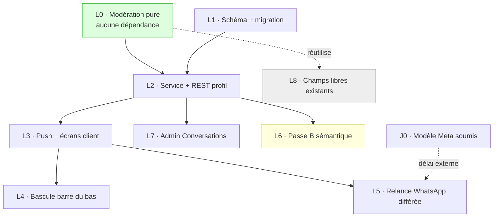

# Phase 3 — Plan d'exécution

Suite de [`01-existant.md`](./01-existant.md) et [`02-architecture.md`](./02-architecture.md).

Neuf lots. Chacun a un objectif, une liste de fichiers, des tests, un critère de sortie et un risque. Chaque lot est une branche de fonctionnalité et une PR vers `develop` — un lot fini avant d'attaquer le suivant.

Aucune estimation en jours : je n'ai pas de base pour en produire une honnête. Ce qui est donné, ce sont les **dépendances**, qui sont vérifiables, et le **volume de surface touchée**, qui l'est aussi.

---

## 0. À faire au jour 0, avant tout code

**Soumettre le modèle WhatsApp de relance à Meta — et ne pas s'en servir tout de suite.**

### Pourquoi un modèle alors que la conversation est in-app

Le modèle ne porte pas la conversation. Il porte la **notification qu'un message est arrivé**, vers quelqu'un qui n'a pas l'app ouverte. Rabotka est WhatsApp-first — l'onboarding s'y fait et `Profile.email` est nullable (`schema.prisma:406-565`) — donc WhatsApp est souvent le seul canal pour atteindre une personne.

`NotificationDispatcher` envoie en **texte libre gratuit** quand la fenêtre de 24 h est ouverte et ne retombe sur un modèle payant que sinon. Le chiffre qui décide : le backfill de `Profile.last_inbound_at` a donné **6 profils sur 53** avec une fenêtre jamais ouverte. Sans modèle, ~89 % des destinataires ne sont prévenus de rien, et l'onglet Discussion se remplit sans que personne ne le sache.

### Pourquoi aucun modèle existant ne convient

Vérifié : le seul candidat des ~35 modèles de `src/common/constants/whatsapp-templates.ts` est `openApp` / `rabotka_open_app_v2` (`:443`), dont le corps dit « Suite à votre message, voici l'accès à votre espace Rabotka » (`scripts/whatsapp-templates/definitions.ts:325-337`). Le destinataire d'un message n'a rien écrit : la phrase serait fausse.

Et le détourner serait cher. Le commentaire du fichier (`:430-442`) explique que la **v1 a été classée MARKETING par Meta parce que sa copie ne s'ancrait pas sur l'état réel**, et que la v2 a été refaite pour corriger ça. Un reclassement rendrait la carte coupable par l'opt-out marketing — or c'est « la seule porte d'entrée d'un compte bloqué ». Réutiliser mettrait en risque un chemin critique existant pour économiser une soumission.

### Soumettre ≠ utiliser

Deux décisions distinctes, et c'est le point à tenir :

| | Quand | Pourquoi |
|---|---|---|
| **Soumettre** | jour 0 | le délai de validation Meta ne se rattrape pas ; une soumission ne coûte rien et achète de l'optionnalité |
| **Utiliser** | après mesure | même logique que la passe B (§8) : on n'allume pas une dépense sur une supposition |

L5 part donc en production avec la relance **uniquement dans la fenêtre ouverte**, donc gratuite. On observe combien de destinataires reviennent seuls. On n'allume le modèle payant que si ce chiffre est mauvais, via `messaging.nudge_template_enabled` (§11).

Cette prudence n'est pas gratuite en confort : tant que l'interrupteur est éteint, ~89 % des destinataires ne reçoivent aucune relance. C'est une privation assumée le temps de la mesure, pas un état cible.

Le contexte de coût la justifie : depuis le 1er octobre, Meta facture les modèles UTILITY **au message, même dans la fenêtre de 24 h**. Une messagerie active produit beaucoup de relances — le regroupement différé de §7 n'est pas un confort, c'est le mécanisme qui borne la facture.

### Forme du modèle

Contraintes tirées du rejet précédent (code 2388293, ratio variables/mots, sur le modèle de diffusion) : beaucoup de texte statique, peu de variables. Le contenu du message n'y figure **jamais** (§6.3 de la Phase 2) — la relance dit qu'il y a un message et renvoie dans l'app, donc **une seule variable**, le prénom.

Catégorie demandée : UTILITY. C'est une notification transactionnelle déclenchée par l'action d'un tiers, pas une promotion. ⚠️ **HYPOTHÈSE** — Meta a reclassé le modèle de diffusion en MARKETING contre notre demande ; le risque existe et ne sera visible qu'à la soumission. Raison de plus pour soumettre au jour 0 : si reclassement il y a, on le saura avant d'avoir construit L5 autour.

Fichier : `scripts/whatsapp-templates/definitions.ts`, à côté des autres.

---

## 1. Les lots et leurs dépendances

L0 et L1 sont parallélisables et n'ont aucune dépendance. L6 est délibérément **après** la mise en production de L2 : son dimensionnement dépend d'un taux mesuré, pas supposé (§5.2 de la Phase 2).

---

## 2. L0 — Modération pure

**Le lot le plus important, et le seul dont une erreur est invisible.** Aucun Nest, aucune base, aucun réseau : des fonctions pures et leurs tests.

### Fichiers créés

| Fichier | Contenu |
|---|---|
| `src/modules/profile-chat/moderation/normalize.ts` | `normalizeWithMap(input) → { normalized, map }` |
| `src/modules/profile-chat/moderation/patterns.ts` | les six familles de motifs, chacune avec son identifiant |
| `src/modules/profile-chat/moderation/detect.ts` | passe A : applique les motifs, reporte les spans sur l'original, fusionne les chevauchements |
| `src/modules/profile-chat/moderation/redact.ts` | construit la vue masquée à partir du texte et des spans |
| `src/modules/profile-chat/moderation/__tests__/` | les suites |

### Fichier modifié

`src/modules/rag/agent/guard.service.ts` — **uniquement** pour exporter `PHONE_PATTERNS`, `EMAIL_PATTERN` et `CONTACT_REQUEST_PATTERNS` (`:17-23`, `:103-131`), aujourd'hui des `const` de module. Aucun changement de comportement, aucune ligne de logique touchée.

Recopier ces motifs ailleurs créerait deux vérités qui divergeraient au premier contournement observé. Les exporter est la plus petite modification qui l'évite.

### Tests — c'est ici que le lot se joue

`normalizeWithMap` :
- chaîne vide, chaîne entièrement ponctuation, chaîne d'un seul caractère
- accents composés et décomposés (`é` en un point de code et en deux)
- émojis et caractères hors BMP — `String.length` compte en UTF-16, un émoji vaut 2
- **invariant, sur un corpus généré** : pour tout texte, `map` est de la longueur de `normalized`, croissant au sens large, et tout index pointe dans `input`

`detect` :
- les formats congolais réels, écrits comme les gens les écrivent
- **la liste des non-détections, qui est la vraie spécification** : « 6 ans d'expérience », « 2 enfants », « 15000 FCFA », « le 12 mars », « 4 heures par jour ». Un faux positif ici casse une conversation légitime entre deux personnes qui travaillent.
- chevauchements : un numéro qui satisfait deux motifs produit **un** span, pas deux
- les offsets renvoyés découpent bien le fragment attendu dans l'**original** — c'est l'assertion qui attrape une erreur de table de positions

`redact` :
- spans adjacents, spans en début et fin de chaîne, span couvrant tout le texte
- substitution de la fin vers le début (sinon les offsets glissent)

**Critère de sortie :** `node_modules/.bin/jest src/modules/profile-chat/moderation` au vert, et la liste des non-détections relue par quelqu'un qui connaît les usages locaux. Cette relecture est un livrable, pas une politesse.

**Risque :** les faux positifs. Atténuation : la liste des non-détections est écrite **avant** les motifs, pas après.

---

## 3. L1 — Schéma et migration

### Fichiers

- `prisma/schema.prisma` — trois modèles, une table de signalement, deux énumérations (§2 de la Phase 2)
- `prisma/migrations/<horodatage>_profile_messaging/migration.sql`

Convention du dépôt : `AAAAMMJJHHMMSS_sujet_en_snake_case`, comme `20260921140000_broadcasts`.

### Contenu

`profile_conversations`, `profile_messages`, `message_redactions`, `redaction_reports`, plus `MessageModerationStatus` et `RedactionCategory`.

Quatre tables neuves, **aucune colonne ajoutée à une table existante**, donc aucun verrou sur `profiles` ou `applications`. C'est une propriété du modèle retenu en Phase 2 (D4 : l'état de déblocage n'est pas dupliqué) et c'est ce qui rend cette migration sans risque de production.

Index à ne pas oublier, parce qu'ils portent des requêtes du chemin chaud :
- `[worker_id, last_message_at]` et `[employer_id, last_message_at]` — la liste des conversations
- `[conversation_id, created_at]` — le fil
- `@@unique([application_id])` — la règle « une candidature, une conversation », qui rend la création paresseuse idempotente sans verrou

### Déploiement

**La migration passe avant le démarrage de l'application.** Ce n'est pas théorique : au chantier précédent, oublier `migrate deploy` a produit un 500 en production sur une colonne absente. `node_modules/.bin/prisma migrate deploy`.

**Critère de sortie :** migration appliquée sur une base de recette, `prisma migrate status` propre, aucune dérive signalée.

**Piège connu, à ne pas déclencher :** `applications_live_unique` est un index **partiel** créé en SQL brut que Prisma ne sait pas exprimer ; un `migrate dev` proposera de le supprimer. Le commentaire du schéma (`schema.prisma:919-922`) dit quoi faire : refuser, et le reporter à la main.

---

## 4. L2 — Service et API profil

Le lot qui rend la fonctionnalité réelle. **Passe A uniquement** — la passe B arrive en L6.

### Fichiers créés

| Fichier | Rôle |
|---|---|
| `profile-chat.module.ts` | le module |
| `profile-chat.service.ts` | ouverture paresseuse, envoi, liste, fil, non-lus, marquage lu |
| `profile-chat.controller.ts` | `@Controller('profile/discussions')` |
| `moderation/moderation.service.ts` | orchestration (une seule passe pour l'instant) |
| `dto/` | envoi, pagination, signalement |
| `__tests__/` | |

### Fichiers modifiés

- `src/app.module.ts` — importer le module
- `src/modules/system-config/system-config.constants.ts` — les clés de §8

### Endpoints

Sous `profile/discussions`, conforme aux sous-espaces existants (`profile/wallet`, `profile/applications`) :

| Verbe | Chemin | Note |
|---|---|---|
| `GET` | `/` | liste paginée `{ data, total, page, limit }`, page en base 1 |
| `GET` | `/:id/messages` | fil paginé |
| `POST` | `/:id/messages` | envoi — **le seul endpoint modéré** |
| `POST` | `/:id/read` | marque lu |
| `POST` | `/messages/:messageId/report` | signalement de faux positif |

Pas d'enveloppe de réponse : le dépôt renvoie `{ application }`, `{ ok: true }`. Pas de DTO de pagination partagé non plus — le modèle canonique à recopier est `contact-unlock/dto/admin-list-contact-records.dto.ts:27-93`.

### Gardes et débit

`ProfileAuthGuard` puis `ActiveProfileGuard`, posées par handler et jamais sur la classe (`active-profile.guard.ts:30-32`).

Appartenance à la conversation vérifiée **à la route et re-vérifiée dans le service**, conformément à la convention écrite dans `contact-unlock.service.ts:206-218`.

`@Throttle` sur l'envoi, décorateur déjà employé dans le dépôt (`referral.controller.ts:41`) avec `ThrottlerGuard` déjà en `APP_GUARD` (`app.module.ts:214`). Rien à installer.

### Le point à ne pas rater

**La réponse servie au destinataire ne contient jamais les caractères masqués** (§4.4 de la Phase 2). Deux sérialisations distinctes selon que le lecteur est l'auteur ou non. Un test doit l'affirmer explicitement, parce que c'est la ligne qui fait la différence entre une fonctionnalité et une décoration : un masquage côté client laisserait le numéro lisible dans l'onglet réseau.

### Tests

- envoi propre → `CLEAN`, aucune ligne de rédaction
- envoi avec numéro → `REDACTED`, spans en base, **et la vue destinataire ne contient pas les chiffres**
- un tiers ne peut ni lire ni écrire dans une conversation
- ouverture paresseuse concurrente : deux envois simultanés sur une candidature vierge → une seule conversation (l'unicité sur `application_id` doit être attrapée et rejouée, pas remontée en 500)
- conversation close → envoi refusé
- non-lus : n'incrémente pas pour l'auteur

**Critère de sortie :** un aller-retour complet en recette entre deux vrais profils, dont un message avec numéro dont on vérifie, dans la charge utile réseau du destinataire, que les chiffres sont absents.

---

## 5. L3 — Temps réel et écrans client

### Backend

`src/modules/profile-chat/profile-chat.gateway.ts`, copie de structure de `ProfileNotificationsGateway` : JWT profil à la poignée de main, rejet si `type !== 'profile'`, room `profile:{profileId}` **dérivée du jeton, jamais du client** (`profile-notifications.gateway.ts:16-19, 73`).

**Aucun `@SubscribeMessage`.** C'est la décision D2 et elle est tenue ici : le `ValidationPipe` global ne s'applique pas aux passerelles, et `chat.gateway.ts:116-121` montre ce que ça coûte.

L'adaptateur Redis est déjà global (`main.ts:191-194`) : rien à faire pour le multi-instance. Ne **pas** reposer un second adaptateur dans `afterInit` — `ws-notifications.gateway.ts:49-69` le fait et c'est une bizarrerie à ne pas propager.

### Client — `rabotka-client`

| Fichier | Nature |
|---|---|
| `src/pages/discussions.tsx` | liste |
| `src/pages/discussion-detail.tsx` | fil |
| `src/lib/api/discussions-controller.ts` | client d'API |
| `src/app/routes/index.tsx` | deux routes en `lazy`, dans le style des lignes existantes (`:60`, `:74`, `:218`, `:391`) |

UI : `bg-card shadow-soft`, pas de bordures, arrondis discrets, boutons plats — la convention du produit.

Le CTA « Débloquer les coordonnées » (décision produit 3.2) est dans l'en-tête du fil et **renvoie au parcours de déblocage existant**. Ce n'est pas un nouveau parcours de paiement.

L'affichage des rédactions porte la décision 3.1 : côté expéditeur, les fragments retenus sont marqués **en place** dans son propre message, pas résumés par un bandeau en dessous. Il doit voir *lequel* de ses numéros n'est pas passé.

**L'avertissement de §8.4 fait partie de ce lot, pas d'une passe de finition.** Trois emplacements : permanent en en-tête du fil, sous un fragment retenu chez l'expéditeur, une fois par fil chez le destinataire. Rendu par le client, jamais stocké en base — le raisonnement est dans §8.4 de l'architecture.

La raison de le livrer *avec* le masquage et pas après : un masquage sans avertissement n'apprend pas la règle, il apprend à la contourner. Et le jour où une tentative répétée entraînera une sanction, « la personne savait-elle ? » sera la seule question qui compte.

**Critère de sortie :** deux téléphones, deux comptes, un message qui arrive sans rechargement — et l'avertissement visible avant la première tentative, sans avoir eu à faire défiler.

**Risque :** ⚠️ **HYPOTHÈSE** — les tests jsdom de `rabotka-client` ne tournent pas en local (liaison canvas manquante). Les helpers purs (formatage, non-lus) se testent en environnement node ; l'écran se valide à la main.

---

## 6. L4 — Bascule de la barre du bas

Le plus petit lot du plan, et le seul visible de tous les utilisateurs le jour de la mise en production.

| Rôle | Retiré | Devient | Destination du retiré |
|---|---|---|---|
| Travailleur | Réclamations | **Discussion** | menu Profil — **déjà présent** (`src/pages/profile.tsx:299`) |
| Employeur | Missions | **Discussion** | menu Profil — **à ajouter** |

Fichiers : `src/features/navigation/config/tabs.tsx:19-32` (les deux tableaux) et `src/pages/profile.tsx` pour la ligne Missions employeur, dans le style des lignes voisines (Portfolio `:263`, Tableau de bord `:275`, Profils contactés `:287`, Réclamations `:299`, Portefeuille `:307`, Support `:310`).

**L'ordre compte : la ligne du menu Profil est ajoutée avant que l'onglet ne parte.** L'inverse supprime un accès au lieu de le déplacer, et côté employeur `/missions` n'est aujourd'hui nulle part ailleurs.

Le badge de non-lus n'est pas à inventer : `notification-bell.tsx` et `read-state.ts` font déjà « rien à 0, le nombre jusqu'à 9, puis 9+ ».

**Critère de sortie :** les deux barres à cinq entrées, et `/missions` atteignable côté employeur.

---

## 7. L5 — Relance WhatsApp différée

Dépend du modèle soumis au jour 0.

### Fichiers

- `src/modules/profile-chat/profile-chat.queue.ts` — planification et annulation
- `src/modules/profile-chat/profile-chat.processor.ts` — l'envoi
- `src/worker.module.ts` — câblage du processeur
- `src/common/services/queue/queue.module.ts` — déclaration de la file
- `scripts/whatsapp-templates/definitions.ts` — le modèle

### Mécanique

Job **différé** de quelques minutes, identifiant de job **stable par conversation**, remplacé à chaque nouveau message : dix messages en trois minutes produisent une relance, pas dix. Annulé si le destinataire lit entre-temps.

Envoi par `NotificationDispatcher.send(...)` (`notification-dispatch/notification-dispatcher.service.ts:100`) — gratuit en texte libre si la fenêtre de 24 h est ouverte, modèle payant sinon. Brique du chantier précédent, réutilisée sans modification.

**L5 part avec `messaging.nudge_template_enabled` à `false`** (§0). Fenêtre ouverte → relance gratuite ; fenêtre fermée → **rien n'est envoyé**, et un compteur monte. Ce compteur est la mesure : il dit exactement combien de relances le modèle payant aurait coûté, avant de dépenser quoi que ce soit. Le dispatcher gère déjà les deux cas, donc l'interrupteur porte sur l'appel, pas sur sa logique.

### Deux pièges déjà payés au chantier précédent

1. **Identifiants de job et rejeux.** BullMQ conserve les jobs terminés une heure et **ignore silencieusement** un identifiant déjà vu. Un identifiant stable est ici voulu (c'est le mécanisme de regroupement) mais il doit intégrer une fenêtre temporelle, sans quoi la deuxième relance d'une conversation active est avalée sans trace. C'est exactement le défaut qui avait laissé une diffusion bloquée en `SENDING`.

2. **Câblage du worker.** Importer le module complet dans `worker.module.ts` fait remonter tout le graphe de dépendances et **fait planter le worker au démarrage** — vécu avec `BroadcastModule`, qui tirait `AuthModule` puis `PaymentsModule`. Le processeur se câble à la main, `useFactory` avec ses dépendances explicites, en suivant le motif déjà présent dans ce fichier.

**Rappel de déploiement :** le process worker doit tourner. Sans lui, aucune relance ne part et rien ne le signale.

**Critère de sortie :** message envoyé à un destinataire hors ligne → une relance après le délai ; trois messages rapprochés → toujours une seule ; lecture avant échéance → aucune.

---

## 8. L6 — Passe B sémantique

**Après la mise en production de L2**, pas avant. La raison est dans le plan : le taux de déclenchement de l'heuristique doit être **mesuré**, et il ne peut l'être qu'une fois que de vrais messages passent par la passe A.

### Fichiers

- `moderation/semantic.ts` — prompt, appel, parsing
- `moderation/moderation.service.ts` — modifié : conditions de déclenchement, quota, interrupteur
- `src/modules/rag/llm/metrics.ts` — une étiquette d'usage dédiée, pour distinguer la messagerie du bot

### Forme de l'appel

`LlmService.invoke(input, options)` (`llm.service.ts:383`), tier le moins cher, `reserveMs: 0` (aucun successeur à protéger), `timeoutMs` explicite.

**Question binaire, `OUI`/`NON`, une ligne de parsing.** C'est imposé : aucune sortie structurée n'existe dans le dépôt (Phase 1 §2.15), donc pas d'offsets. Un message que seule la passe B attrape part en `HELD`, entier.

**Le message seul part chez le fournisseur** : pas de nom, pas d'identifiant, pas d'historique. Contrairement au prompt du bot, qui transmet prénom, statut KYC et six tours (`agent.service.ts:950-974`).

**Budget au-dessus de 1 500 ms**, parce que `VOVA_LLM_MIN_CALL_MS` vaut 1 500 et sert de plancher : en dessous, le service refuse l'appel (`llm.service.ts:184-199`). Point de départ 2 500 ms, en configuration.

### Échec = passage

Disjoncteur ouvert, chaîne épuisée, délai dépassé, réponse non parsable : **le message part**. Un compteur monte, rien ne bloque. C'est déjà la posture du bot, qui sert une carte statique plutôt qu'une erreur (`agent.service.ts:1040-1050`).

Un test doit le prouver en simulant chaque mode de panne. C'est le test qui protège la production d'une panne de fournisseur américain.

### Tests

- heuristique non déclenchée → **aucun appel LLM** (à affirmer, c'est tout le contrôle du coût)
- conversation débloquée → aucun appel
- quota épuisé → aucun appel
- interrupteur coupé → aucun appel
- les quatre modes de panne → message remis

**Critère de sortie :** taux de déclenchement observé en recette, et les compteurs de jetons visibles séparément de ceux du bot.

---

## 9. L7 — Module admin Conversations

### Backend

- `admin-profile-chat.controller.ts` — `@Controller('admin/conversations')`
- `admin-profile-chat.service.ts`
- `src/modules/auth/guards/lateral-access.ts` — **modifié**

Deux niveaux, parce que lire qui parle à qui et lire ce qu'ils se disent ne sont pas le même acte :

| Surface | Rôle | Audit |
|---|---|---|
| Liste, fiche, compteurs de rédactions par catégorie | `MODERATOR` | non |
| Lecture du fil | `MANAGER` | **une ligne `Log` par consultation** |
| File des signalements | `MODERATOR` | non |

`LogService.create({ action, entityType, entityId, ... })` + `extractRequestMeta(req)`, action en `SCREAMING_SNAKE`, comme les ~101 appels existants.

**`LATERAL_ACCESS` refuse tout ce qui n'y figure pas** (`lateral-access.ts:29-32`). Proposition : `'admin/conversations': 'read'` pour SUPPORT, aligné sur `admin/contact-records: 'read'` et `admin/feedback: 'read'`, accordés pour la même raison. FINANCE reste absent : il n'y a pas d'argent dans un fil. **C'est la question ouverte n° 7 de la Phase 2 — à valider avant d'écrire la ligne.**

### Admin — `rabotka-admin`

La recette est fixe et son oubli le plus coûteux est connu : une page qui s'affiche et dont toutes les requêtes répondent 403, parce que le préfixe manque des **deux** listes.

| Étape | Fichier |
|---|---|
| Route | `src/routes/_authenticated/conversations/` |
| Page | `src/pages/conversations.tsx` (`PageListHeader` + `DataTable`) |
| Feature | `src/features/conversations/` |
| Hook | `src/hooks/use-conversations-list.ts`, parseurs **nuqs**, l'URL est la source de vérité |
| API | `src/lib/api/conversations-controller.ts` |
| Barre latérale | `src/layouts/app-sidebar.tsx` |
| Accès latéral | `src/lib/role-access.ts` → `LATERAL_ROUTES` |

Les codes d'action s'humanisent seuls via `src/lib/log-labels.ts`, mais **un nouveau `entityType` doit être ajouté à `RECORD_TYPES`**.

**Critère de sortie :** un compte SUPPORT ouvre la liste sans 403 ; un compte MODERATOR voit les compteurs et se fait refuser le fil ; une consultation de fil produit une ligne dans les journaux.

---

## 10. L8 — Les champs libres existants

**Hors v1, mais c'est le contournement.** Une ligne de bio suffit à annuler toute l'architecture.

Phase 1 §2.17 : aucun champ libre saisi par un utilisateur n'est filtré aujourd'hui, au mieux un `trim()`. La passe A de L0 s'y applique telle quelle.

Priorité par exposition :

1. `PortfolioItem.description` — **page publique non authentifiée** (`portfolio.service.ts:443-450`), donc lisible sans compte
2. `Profile.description` — sans borne du tout à la création (`profile/dto/create-profile.dto.ts:77-81`)
3. `JobOffer.description` et `JobOffer.address` — cette dernière sans maximum

Court lot, réutilisation intégrale, aucun nouveau concept. À planifier juste après L2, pendant que L3 avance.

---

## 11. Clés de configuration

Toutes sous `ConfigCategory.GENERAL`, préfixe `messaging.`, dans `system-config.constants.ts`.

**Pourquoi `GENERAL` :** `CONTACT` héberge les coordonnées de Rabotka elle-même (`contact.email`, `contact.phone`, `contact.orange_money_number`), rien à voir. `GENERAL` héberge déjà les réglages Vova, lus par `rabotka-admin/src/pages/settings/vova-card.tsx:70` via `useSystemConfigCategory("GENERAL")`. Une carte `messaging-card.tsx` à côté suit le motif exact, **sans migration d'énumération**.

| Clé | Défaut | Ce que ça achète |
|---|---|---|
| `messaging.enabled` | `true` | couper la fonctionnalité sans déploiement |
| `messaging.semantic_enabled` | `false` | la passe B arrive éteinte, allumée à L6 |
| `messaging.semantic_budget_ms` | `2500` | au-dessus du plancher de 1 500 ms |
| `messaging.semantic_daily_quota_per_conversation` | à fixer | un fil ne peut pas devenir une facture |
| `messaging.operator_prefixes` | vide | les préfixes congolais, sans redéploiement |
| `messaging.held_ratio_threshold` | à fixer | au-delà, le message est retenu entier |
| `messaging.rate_limit_per_minute` | à fixer | anti-spam |
| `messaging.nudge_delay_seconds` | à fixer | regroupement des relances |
| `messaging.nudge_template_enabled` | `false` | §0 — la relance hors fenêtre de 24 h est la seule payante ; elle s'allume après mesure, pas à la mise en production |

Le cache Redis de `SystemConfigService` est de 5 minutes (`system-config.service.ts:20-21`) : un changement ne prend pas effet instantanément, et c'est à savoir le jour où il faudra couper vite.

---

## 12. Mise en production

Ordre, pour chaque lot touchant le backend :

1. `node_modules/.bin/prisma migrate deploy` — **avant** le démarrage de l'application
2. redémarrage de l'API
3. redémarrage du **worker** — process distinct, oublié c'est zéro relance et aucune alerte

Interrupteurs à la mise en production : `messaging.enabled` à `true`, `messaging.semantic_enabled` à `false`, `messaging.nudge_template_enabled` à `false`.

**Les deux dépenses de la fonctionnalité arrivent éteintes** — la passe B (jetons LLM) et la relance hors fenêtre (modèles Meta). Chacune s'allume sur un chiffre observé, pas sur une estimation.

**Ne jamais utiliser l'outil de mise à jour intégré de Portainer.**

---

## 13. Risques transverses

| Risque | Où | Ce qui le contient |
|---|---|---|
| Faux positifs de détection | L0 | la liste des non-détections écrite avant les motifs ; les motifs en configuration ; le corpus de signalements |
| Table de positions fausse | L0 | l'invariant testé sur corpus généré ; les assertions portent sur des découpes de l'original |
| Masquage contourné côté client | L2 | deux sérialisations serveur ; un test qui affirme l'absence des chiffres dans la vue destinataire |
| Coût LLM non borné | L6 | quota par conversation, interrupteur, compteur dédié, déclenchement conditionnel |
| Panne fournisseur bloquant les messages | L6 | échec = passage, prouvé par test sur les quatre modes de panne |
| Relances en rafale | L5 | identifiant de job stable et fenêtré ; annulation à la lecture |
| Facture Meta non bornée | L5 | modèle payant éteint au départ ; facturation au message depuis le 1er octobre, même dans la fenêtre ; le regroupement différé est le mécanisme de borne |
| Destinataires jamais prévenus | L5 | conséquence assumée de l'interrupteur éteint : ~89 % des fenêtres sont fermées. C'est ce que le compteur mesure, et ce qui décide de l'allumer |
| Worker qui ne démarre plus | L5 | câblage manuel du processeur, jamais l'import du module |
| Page admin en 403 | L7 | le préfixe dans `LATERAL_ACCESS` **et** dans `LATERAL_ROUTES` |
| Numéros en clair en base | transverse | trois lectures seulement, consultations journalisées, rétention à trancher |
| Modèle Meta refusé ou reclassé | J0 | soumis au jour 0 ; beaucoup de texte statique, une seule variable |

---

## 14. Ce qui reste en dehors, et doit être dit au produit

- **Aucune pièce jointe.** Une photo d'un numéro écrit à la main traverse toute cette architecture, et rien dans le dépôt ne sait lire une image.
- **Aucun appel ni message vocal**, pour la même raison en pire.
- **Le chemin recommandation n'a pas de messagerie** (`recommendation-contact.service.ts:40-45` ne crée aucune ligne d'état). La colonne `application_id` nullable rend l'ajout ultérieur faisable sans migration — c'est tout ce que v1 garantit.
- **Aucune comptabilité LLM en argent.** Les compteurs sont en jetons. C'est un chantier utile à tout le produit, qui ne doit pas être payé par celui-ci.
- Les neuf points de dette hors périmètre de la Phase 1 §5 restent ouverts, dont les trois passerelles non authentifiées à room fournie par le client.

---

## 15. Les cinq questions qui bloquent encore

Reprises de la Phase 2 §9, réduites à celles qui changent le plan :

1. **Volume de messages par mise en relation** — sans elle, les garde-fous de §11 sont la réponse, et ils sont paramétrables dès L2.
2. **Latence réelle d'une classification courte**, sur Prometheus — fige `messaging.semantic_budget_ms`.
3. **Préfixes opérateurs congolais** — à fournir, ils vont en configuration.
4. **§7.3 : SUPPORT peut-il lire un fil ?** Proposé oui, journalisé. Bloque la ligne de `LATERAL_ACCESS` en L7, rien d'autre.

Aucune ne bloque L0 ni L1.
