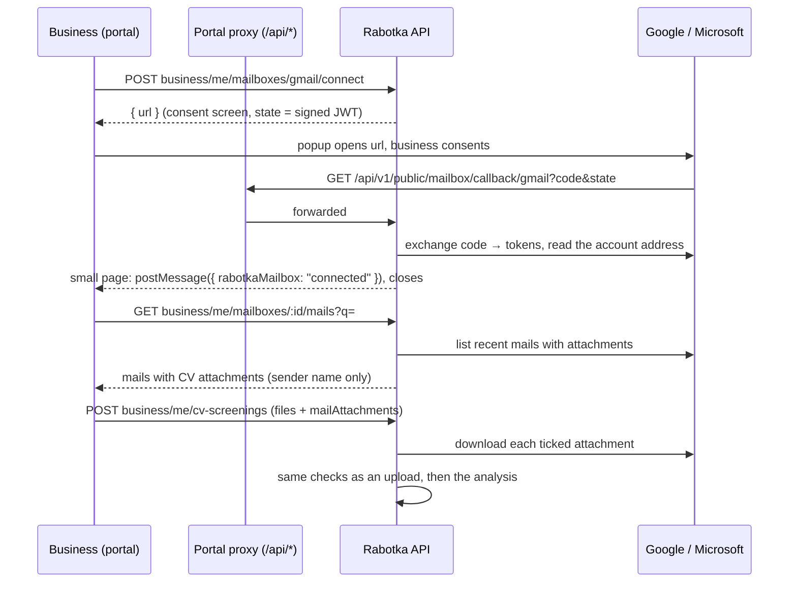

# Analyse de CV — importing CVs from a mailbox

A business connects its Gmail or Outlook mailbox, sees recent mails that carry a
CV, ticks the ones it wants, and they join the analysis next to uploaded files.
Rabotka reads only the attachments the business ticks. It stores no mail, only
the OAuth tokens, encrypted.

Shipped in rabotka-backend #979 (5-CV cap) and #980, rabotka-admin #386, and
rabotka-business #100.

## The flow



1. **Connect.** On « Nouvelle analyse » (or Organisation), the business clicks
   « Connecter Gmail » or « Connecter Outlook ». The consent screen opens in a
   popup.
2. **Back from consent.** The provider redirects to the callback. The API turns
   the code into tokens, stores them encrypted, and returns a page that tells
   the portal it worked and closes itself.
3. **Pick.** A drawer lists the mails from the last 120 days that have a CV
   attachment. The business can search, load more, and tick attachments.
4. **Analyse.** On « Lancer l'analyse », the portal sends the uploaded files plus
   references to the ticked attachments. The API downloads them and passes
   everything through the normal analysis.
5. **Disconnect.** « Déconnecter » revokes the token where the provider supports
   it, and deletes the row.

## The cap: 5 CVs per analysis

- `business_plans.cv_batch_max` defaults to 5. Migration
  `20261028190000_cv_batch_max_five` brought existing plans down to at most 5.
- Admin: the plan dialog's « CVs per upload » accepts 1 to 5. The API refuses
  more with `@Max(5)` on `cvBatchMax`.
- It is enforced in `CvScreeningService.create`, on uploaded files and mail
  attachments together.
- Before that check, `MailboxService.download` refuses more than 5 references.
  The DTO also has `@ArrayMaxSize(5)` on `mailAttachments`.
- Portal: `room = min(cvBatchMax, cvRemaining)`. The drop zone and the drawer
  both count against it (« 2 / 5 »).

## Data model

```prisma
enum MailProvider { GMAIL OUTLOOK }

model BusinessMailbox {            // table business_mailboxes
  id                      String   @id @db.Uuid
  business_id             String   @db.Uuid   // cascade on business delete
  provider                MailProvider
  email                   String              // lower-cased account address
  connected_by_profile_id String   @db.Uuid
  refresh_token_enc       String              // sealed
  access_token_enc        String?             // sealed, short-lived
  access_expires_at       DateTime?
  expired_at              DateTime?           // provider refused the refresh token
  last_used_at            DateTime?
  created_at / updated_at
  @@unique([business_id, provider, email])
}
```

- Connecting the same address again updates its row and clears `expired_at`.
- A business can connect several addresses with the same provider.

### Token encryption

- AES-256-GCM, key `MAILBOX_TOKEN_KEY` (32 bytes, base64). Code:
  `src/modules/business/mailbox/mailbox-crypto.ts`.
- Format: `iv.tag.cipher`, each part base64url, with a random 12-byte IV per seal.
- A token that was altered, or sealed under another key, fails to open.
- **Key rotation:** there is no dual-key support. If the key changes, the stored
  tokens can no longer be opened, so every business must reconnect. Rotate only
  if the key leaks, and then clear the table:
  `DELETE FROM business_mailboxes;`.

## API

Every `business/me/*` route uses `ProfileAuthGuard` and `BusinessProfileGuard`,
and only touches the caller's own business. Messages are in French and are shown
to the user as they are.

| Method & path | Throttle | Request | Response |
|---|---|---|---|
| `GET business/me/mailboxes` | default | — | `{ available: { gmail, outlook }, mailboxes: [{ id, provider: "gmail"\|"outlook", email, connectedAt, expired }] }` |
| `POST business/me/mailboxes/:provider/connect` | 10/min | `:provider` = `gmail` \| `outlook` | `{ url }` |
| `GET business/me/mailboxes/:id/mails` | 30/min | `?q=` (≤ 200 chars), `?page=` (the previous `next`) | `{ mails: [{ id, fromName, subject, date, attachments: [{ id, name, size, mime }] }], next }` |
| `DELETE business/me/mailboxes/:id` | default | — | `{ ok: true }` |
| `GET public/mailbox/callback/:provider` | 20/min, public | `code`, `state`, or `error` | HTML page (see below) |
| `POST business/me/cv-screenings` | 10/min | multipart: `files[]`, `offerId` or `jobTitle` + `jobText`, **`mailAttachments`** (JSON text: `[{ mailboxId, messageId, attachmentId }]`, ≤ 5) | the screening, as before |

`available.<provider>` is `true` only when that provider's client ID and secret
are set and `MAILBOX_TOKEN_KEY` is valid.

### Errors

| Case | Status | Message |
|---|---|---|
| Unknown provider | 400 | « Messagerie inconnue. » |
| Provider not configured | 503 | « Cette messagerie ne peut pas encore être connectée. » |
| Mailbox not owned or missing | 404 | « Messagerie introuvable. » |
| Refresh token refused, or the mailbox was already expired | 409 | « Votre messagerie ne répond plus : connectez-la de nouveau. » |
| More than 5 references | 400 | « 5 CV au plus depuis votre messagerie. » |
| One attachment can't be downloaded | 400 | « Une pièce jointe n'a pas pu être lue depuis votre messagerie. Réessayez ou retirez-la. » |
| Attachment over 10 MB | 400 | « « nom » est trop lourd pour être analysé. » |
| Not a business | 403 | « Espace réservé aux comptes entreprise. » |

After download, the checks of `CvScreeningService.create` apply: plan quota,
cap, file size and file type (by content). Their messages are unchanged.

### The callback page

- Served by the API, but reached through the portal's origin
  (`<portal>/api/v1/public/mailbox/callback/<provider>`). It is therefore the
  same origin as the portal that opened the popup.
- It calls `window.opener.postMessage({ rabotkaMailbox: status },
  window.location.origin)` and closes after a moment.
- `status` is `connected`, `denied` (the user refused consent) or `error`
  (anything else; the cause is logged as a warning).
- Headers: `Content-Security-Policy: default-src 'none'; script-src
  'unsafe-inline'; style-src 'unsafe-inline'` and `Cache-Control: no-store`.
  The page contains only static text: no address, no token.

## Providers

The code is in `src/modules/business/mailbox/providers/`. Both clients use plain
`fetch` behind one interface, `MailProviderClient`.

### Gmail (`gmail.provider.ts`)

- **Scope:** `https://www.googleapis.com/auth/gmail.readonly` only. The account
  address comes from `users/me/profile`.
- **Consent:** `access_type=offline` and `prompt=consent`, so Google always
  returns a refresh token.
- **List:** `users/me/messages?q=…&maxResults=15`, where `q` is
  `has:attachment {filename:pdf filename:docx filename:jpg filename:jpeg filename:png filename:webp} newer_than:120d <search>`.
  Each message is then fetched with `format=full` and a `fields` mask limited to
  headers and parts.
- **Attachment ids:** the ID returned is the MIME **part ID**, because Gmail's
  `attachmentId` changes on every read. To download, the message is read again,
  the part is found by its ID, and the fresh `attachmentId` is used.
- **Revoke:** `POST https://oauth2.googleapis.com/revoke?token=<refresh>`.

### Outlook / Microsoft 365 (`outlook.provider.ts`)

- **Authority and scopes:** `login.microsoftonline.com/common` (work and
  personal accounts), with `offline_access User.Read Mail.Read`. The address is
  `/me` `mail`, or `userPrincipalName` when `mail` is empty.
- **List:** `/me/messages` with `$top=15`, `$select`, and
  `$expand=attachments($select=id,name,contentType,size,isInline)`.
  - **No search:** `$filter=hasAttachments eq true and receivedDateTime ge <120 days>`
    and `$orderby=receivedDateTime desc`.
  - **With a search:** `$search="…"` and `ConsistencyLevel: eventual`. Graph
    refuses `$filter` together with `$search`, so the attachment and date filters
    are applied in code instead.
- **Paging:** `next` is Graph's `@odata.nextLink`. It is followed only if it
  starts with `https://graph.microsoft.com/v1.0/me/`, so a forged page link
  can't make the server call another host.
- **Attachments:** only `#microsoft.graph.fileAttachment`, downloaded from
  `…/attachments/{id}/$value`. Item attachments (forwarded mails) are skipped.
- **Revoke:** Graph can't revoke a single refresh token, so the row is simply
  deleted. A user who wants to cut access completely removes « Rabotka » at
  https://myapps.microsoft.com (or https://account.live.com/consent/Manage for
  personal accounts).

### Which attachments count as CVs (`cv-attachments.ts`)

- The extension must be `.pdf`, `.docx`, `.jpg`, `.jpeg`, `.png` or `.webp`.
- Images that are inline or smaller than 30 KB are skipped (signatures, logos).
- Empty files are skipped.
- A mail with no attachment left is not listed.

### Tokens over time (`MailboxService.withAccess`)

- **Fresh token:** an access token valid for more than 60 more seconds is used
  as is.
- **Expiring token:** otherwise it is refreshed first. The new access token, and
  any new refresh token (Microsoft rotates them), are stored sealed.
- **Refused call:** if the provider answers 401 with a token believed fresh,
  it is refreshed once and the call is retried.
- **Refused refresh:** `invalid_grant` or a 401 sets `expired_at`, clears the
  access token, and returns the 409. Later calls answer the 409 straight away,
  until the business reconnects.

## Security and privacy

- **What is stored:** the account address and the tokens, sealed. No mail,
  subject, sender or attachment is stored.
- **When mails are read:** only when the business opens the drawer. Attachments
  are downloaded only when the analysis starts. After that, they are ordinary
  analysis files: stored in the private bucket, purged after the plan's retention
  period, like uploads.
- **What the list shows:** the sender's **name**, never the address. With only an
  address, it shows the part before `@`. The CV itself still carries the
  contact details, as with an upload.
- **`state`:** a 10-minute JWT signed with `JWT_SECRET`, with its own audience
  `rabotka-mailbox-connect`. It carries the business, the profile, the provider
  and a nonce. A login token can't be used as a state, nor the reverse.
- **Ownership:** every read checks `business_id` against the caller's business,
  including the `mailboxId` of each reference sent with an analysis.
- **Scopes:** read-only. Nothing is sent from the mailbox, and nothing is
  changed in it.

## Portal (rabotka-business)

| Where | What |
|---|---|
| `src/lib/api/mailbox-controller.ts` | `listMailboxes`, `connectMailbox`, `listMailCvs`, `disconnectMailbox`, `mailboxesKey` |
| `src/lib/api/cv-screening-controller.ts` | `createCvScreening(files, job, mailAttachments)` |
| `src/features/cv-screening/mail-picks.ts` | `MailPick`, `togglePick` (never past the room left), `kindFromName` (tested) |
| `src/features/cv-screening/components/mail-import.tsx` | `useConnectMailbox` (popup + `postMessage`), `MailImport` (the buttons), `MailCvSheet` (the drawer) |
| `src/features/organisation/components/organisation-mailboxes.tsx` | « Messageries connectées » card |

### The popup handshake

- The window is opened on the click itself, so popup blockers allow it, and the
  consent URL is set once the API answers.
- The page then listens for `message` events from its own origin only.
- When a popup is closed without an answer, the button stops waiting.
- If the browser blocks the popup, the whole page goes to the consent URL
  instead.

### Drawer states

| State | Shown |
|---|---|
| Loading | five placeholder cards |
| Mails | one card per mail: name, date, subject; attachments as tiles to tick (PDF / Word / Photo); « Charger plus » |
| Nothing found | « Aucun CV reçu ces 4 derniers mois » (or « Aucun e-mail ne correspond » for a search) |
| 409 | amber note and « Reconnecter Gmail/Outlook » |
| Other error | the API's message, in red |
| Footer | « Rabotka lit uniquement les pièces jointes que vous choisissez ; rien n'est envoyé depuis votre messagerie. », the « n / 5 CV choisis » counter, and « Ajouter n CV » |

Picks appear in the CV list with a mail icon and the sender's name. Each can be
removed like a file, and « Tout retirer » clears both kinds.

Both the buttons and the Organisation card are hidden when no provider is
available, so the page looks as it did before the feature.

## Configuration

| Key | Purpose |
|---|---|
| `GOOGLE_MAIL_CLIENT_ID`, `GOOGLE_MAIL_CLIENT_SECRET` | Google OAuth client ("Web application") |
| `MS_MAIL_CLIENT_ID`, `MS_MAIL_CLIENT_SECRET` | Microsoft Entra app registration |
| `MAILBOX_TOKEN_KEY` | 32 random bytes, base64: `openssl rand -base64 32` |
| `BUSINESS_DASHBOARD_URL` | existing; its origin is the base of the redirect URI (default `https://business.rabotka.work`) |

- **Deploys:** `deploy-production.yml` and `deploy-develop.yml` read the five
  keys from Vault with `// ""`. Each key is optional.
- **Missing values:**
  - A provider missing its ID or secret is reported as unavailable. Its button
    doesn't appear, and connect returns 503.
  - A missing or malformed `MAILBOX_TOKEN_KEY` disables both providers. A
  malformed key also logs `Mailboxes disabled: …` at boot.
  - The API still starts in all these cases.
- **Develop deploy:** the develop workflow doesn't set `BUSINESS_DASHBOARD_URL`,
  so its redirect URI points at the production portal. To use mailboxes on
  develop, add that variable to the develop Vault secret and register the
  develop redirect URI too. The calendar feed links have the same limitation
  today.

Redirect URIs:

```
https://business.rabotka.work/api/v1/public/mailbox/callback/gmail
https://business.rabotka.work/api/v1/public/mailbox/callback/outlook
http://localhost:<portal port>/api/v1/public/mailbox/callback/gmail     (local)
http://localhost:<portal port>/api/v1/public/mailbox/callback/outlook   (local)
```

Locally, set `BUSINESS_DASHBOARD_URL=http://localhost:<portal port>` in the
backend's `.env.local`, so the redirect URI matches what is registered.

## External setup

### Google (Gmail)

1. In [Google Cloud Console](https://console.cloud.google.com/), create or pick
   a project, then enable the **Gmail API** (APIs & Services → Library).
2. Set up the **OAuth consent screen** (Google Auth Platform → Branding /
   Audience):
   - User type **External**, app name « Rabotka Business », support e-mail,
     logo, and the homepage `https://www.rabotka.work` with privacy and terms
     links.
   - Authorized domain: `rabotka.work`.
   - **Data access:** add `https://www.googleapis.com/auth/gmail.readonly`.
   - **Audience:** leave it in **Testing** and add the Google accounts that may
     connect (100 at most) as **test users**.
3. Create the client (Credentials → Create credentials → OAuth client ID):
   - Type **Web application**.
   - Authorized redirect URIs: the Gmail ones above.
   - Copy the client ID and secret into Vault as `GOOGLE_MAIL_CLIENT_ID` and
     `GOOGLE_MAIL_CLIENT_SECRET`.
4. **Opening it to every business:** `gmail.readonly` is a *restricted* scope.
   Publishing the app requires Google's verification:
   - a demo video and scope justification
   - a privacy policy that covers Gmail data, following Google's Limited Use
     rules
   - a yearly third-party security assessment (CASA), which takes several weeks
     and is usually paid

   Until then, only test users can connect, and their consent expires after
   7 days in Testing mode, which shows up as a « Reconnecter » prompt.

### Microsoft (Outlook / Microsoft 365)

1. In the [Microsoft Entra admin center](https://entra.microsoft.com/) or Azure
   Portal, go to **App registrations → New registration**:
   - Name « Rabotka Business ».
   - Supported accounts: **any organizational directory and personal Microsoft
     accounts**.
   - Redirect URI: platform **Web**, the Outlook URI above. Add the local one
     under Authentication.
2. Under **API permissions → Add → Microsoft Graph → Delegated**, add
   `Mail.Read`, `offline_access` and `User.Read`. No admin consent is needed for
   these.
3. Under **Certificates & secrets → New client secret**, copy the secret's
   **Value** (not its ID) into `MS_MAIL_CLIENT_SECRET`. Copy the **Application
   (client) ID** into `MS_MAIL_CLIENT_ID`.
4. Note the secret's expiry date (24 months at most) and renew it before then.
5. Optional: verify the publisher (Branding & properties, with a Microsoft
   Partner ID), so the consent screen stops saying "unverified".

### Vault

Add the five keys to `secret/data/apps/rabotka-backend-production` (and
`…-develop` if used), then redeploy. To check:

- `GET business/me/mailboxes` returns `available.gmail` / `available.outlook`
  as `true`.
- The buttons appear on « Nouvelle analyse ».

## Tests

- **Backend specs** in `src/modules/business/mailbox/__tests__/`:
  - **crypto:** round trip, a changed IV, tampering, the wrong key, key length
  - **attachment filter:** types, inline, small images, empty files
  - **sender names**
  - **callback page:** posts to its own origin only
  - **state:** signing, plus forged, foreign-audience and expired states
  - **availability:** per provider and per key
  - **ownership:** of mails and of downloads
  - **cap:** more than 5 references
  - **tokens:** sealed storage, refresh before expiry, retry after a refused
    access token, expiry on a refused refresh (and no retry after it), revoke
    then delete
  - **Gmail:** nested parts, the query, attachment by part, 401 and
    `invalid_grant` mapping
  - **Outlook:** file attachments only, and only its own next links
- **DTO spec** `cv-screening/__tests__/create-cv-screening.dto.spec.ts`: JSON
  parsing, nested validation, more than 5, a bad UUID, an unknown field, not
  JSON.
- **Portal:** `mail-picks.test.ts`.
- **Manual checklist** (needs real OAuth clients and a test account):
  1. Connect Gmail from « Nouvelle analyse ». The popup closes and the drawer
     opens on the account.
  2. Search a candidate's name; the list narrows.
  3. Tick 2 attachments, add them, add 1 uploaded file; « Lancer l'analyse de
     3 CV ». All 3 get scored.
  4. Try to go past 5; new ticks are disabled.
  5. Revoke Rabotka's access in the Google account. The next listing shows
     « Reconnecter », and reconnecting works.
  6. Disconnect from Organisation. The row is gone, and the Google account no
     longer lists Rabotka.
  7. Repeat 1–3 and 6 with Outlook (a personal account and a work account).
